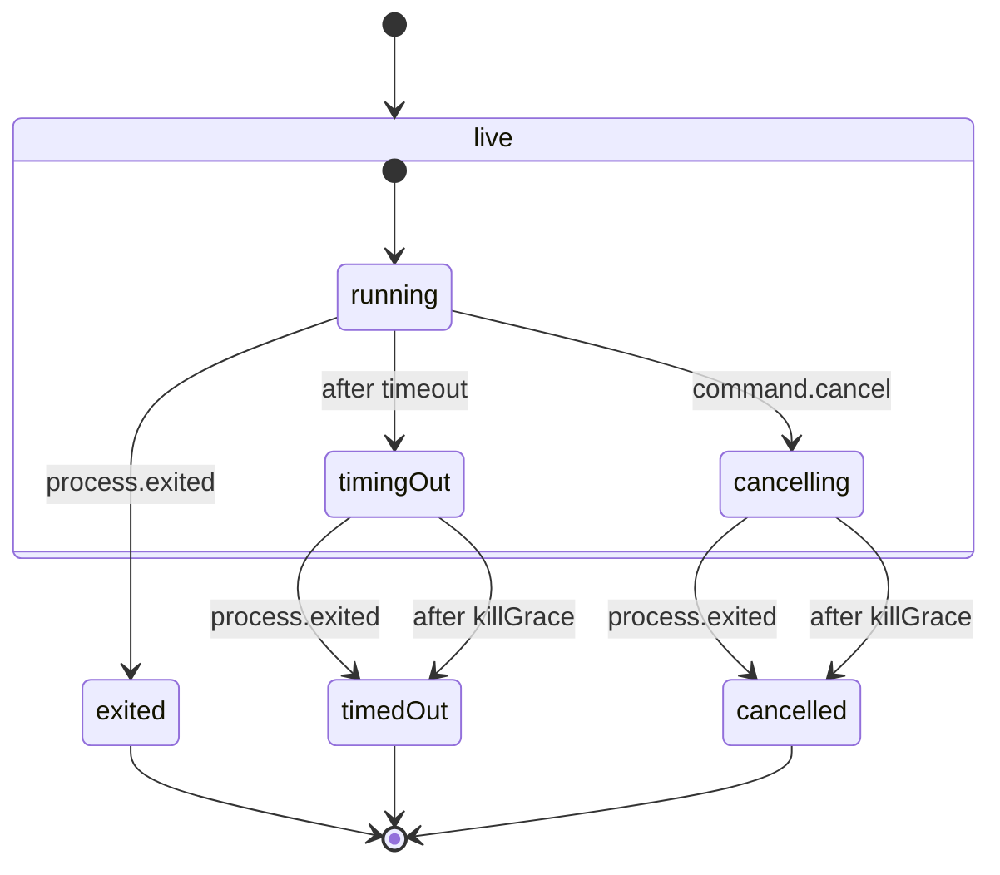

# Agent command on the Windows host

One `POST /v1/run` on the Windows host (`apps/windows/src/agent/command.machine.ts`): a PowerShell command an agent on the Mac Mini runs in Isaac's desktop session. The `process` actor lives for all of `live`, so a killed command can still report what it printed; leaving `live` stops it, which kills whatever is left of its process tree.

- **running**: PowerShell is running; it ends on its own (`exited`), outlives its timeout, or the agent hangs up (the HTTP request is aborted).
- **timingOut / cancelling**: the process tree was told to die (`taskkill /T /F`); it gets `killGrace` (3 s) to exit and hand back its partial output, after which the result has no exit at all.
- **exited / timedOut / cancelled**: what the agent is told as `outcome`; only `exited` carries the command's own exit code.

<!-- diagram:start (generated from the machine by `pnpm machines:docs`; do not edit) -->

<!-- diagram:end -->
