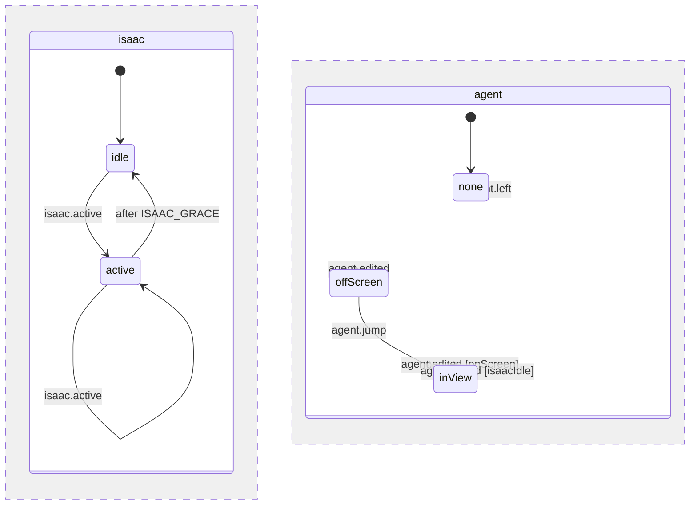

# Live agent edits in rendered Markdown (desktop Files)

How an agent's writes show in a Markdown file open rendered in Files (`apps/desktop/src/renderer/files/markdown/agent-follow.machine.ts`, run by `AgentFollow.tsx`). The edits themselves land in the buffer through the Files disk merge; this decides whether Isaac's view goes to them.

- **isaac.active**: Isaac typed, clicked or scrolled in the editor within `ISAAC_GRACE` (4 s); his view never moves while he works.
- **agent.inView**: the agent's latest edit is on screen with its caret, avatar and caption. An edit off screen gets here by scrolling to it, but only while Isaac is idle.
- **agent.offScreen**: the agent edited out of view while Isaac was working; a pill says who and where (above or below), and `agent.jump` (a click on it) scrolls there.
- **agent.none**: no agent mark in the file (the marks fade 3 s after an agent's last edit).

<!-- diagram:start (generated from the machine by `pnpm machines:docs`; do not edit) -->

<!-- diagram:end -->
