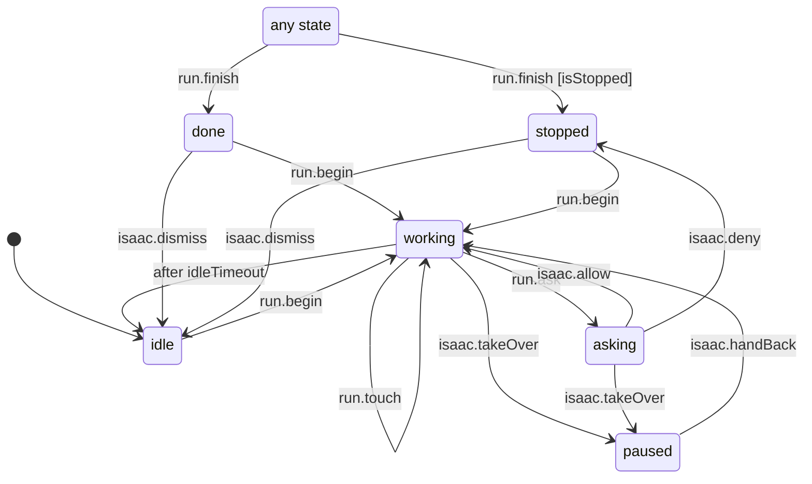

# An agent's run on a surface (browser page, canvas board)

One chat agent's run on one surface Isaac sees: a web page in the shared browser or a canvas board (`packages/shell-core/src/agent-run.machine.ts`, run by `apps/desktop/src/main/agent-presence/agent-runs.ts`; later Relay Assist's screen overlay). Each snapshot is the surface's `AgentRun`: its ring, cursor, caption row and the chat's one-row work card.

- `idle`: nobody drives it right now; the agent's face may still show on the tab.
- `working`: the agent acts (ring, cursor, caption). Every action restarts a 2 minute clock; when it runs out the run goes idle and the cursor leaves.
- `asking`: a purchase, send, submit or delete waits for Isaac's Allow (status `ask`).
- `paused`: Isaac took over (his own input on the surface, or Take over). Agent actions are refused until he hands back.
- `done` / `stopped`: the agent finished (its summary is the caption) or stopped (Isaac said Not now, or the agent gave up). Dismiss clears it; a new action starts a fresh run.
- `run.finish` ends the run from any state and settles an action still waiting for Allow.

<!-- diagram:start (generated from the machine by `pnpm machines:docs`; do not edit) -->

<!-- diagram:end -->
