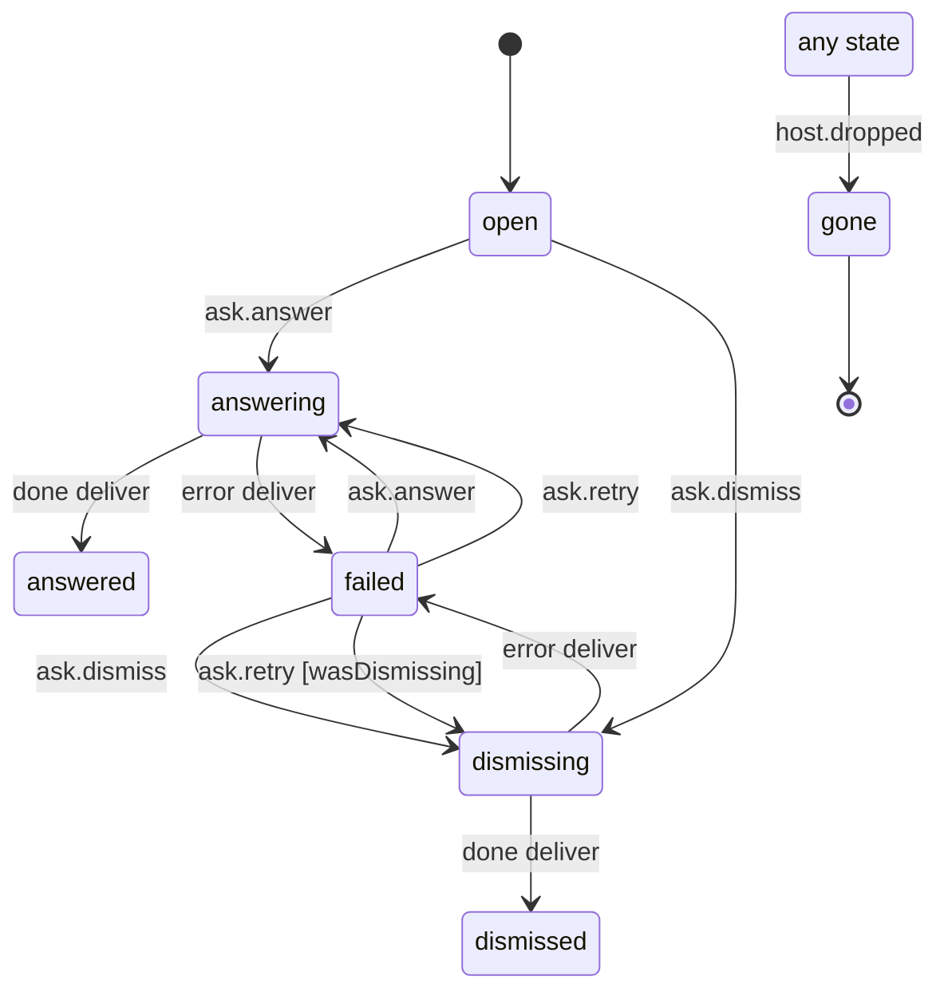

# Answering an ask (card, chip, sheet)

Isaac's answer to one ask (`apps/mobile/src/agents/ask.machine.ts`, run by `agents/asks.ts`, records in `useAgentsStore().askRecords`). A session's ask card and the thread's open ask that stands for it are one record, so the card, a reply chip and the open-questions sheet answer it once, and the record outlives the screen.

- `open`: nothing sent yet.
- `answering` / `dismissing`: the answer (a turn of Isaac's plus `assistant.ask.resolve`, or `agent.ask.answer`) or the dismissal is on its way. The card stays until the ack; the thread's row hides. Another answer meanwhile is refused.
- `answered` / `dismissed`: the host acked it; card and row stay hidden until the host drops the ask.
- `failed`: a timeout or refusal. The card and row show again with the reason in the banner; answering again, or a retry, sends the same unit (the same turn `clientId`).
- `gone`: the host no longer lists the ask (resolved card and open ask gone), from any state.

<!-- diagram:start (generated from the machine by `pnpm machines:docs`; do not edit) -->

<!-- diagram:end -->
