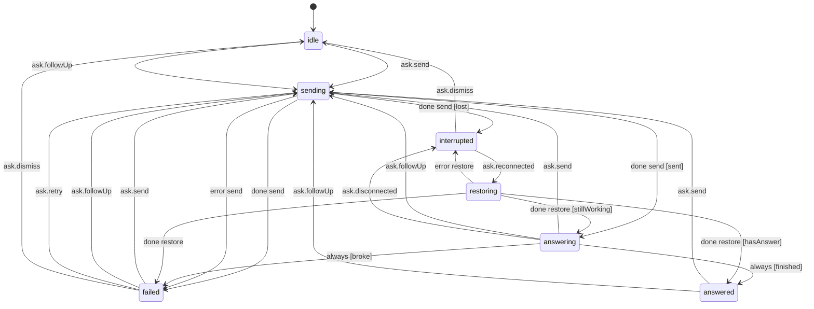

# A private ask to an assistant on a ticket (desktop)

One assistant's private asks on a ticket (`apps/desktop/src/renderer/tickets/assistant-ask.machine.ts`, run by `useAssistantSession()` in `AssistantReply.tsx`). A message on the ticket page that mentions an assistant (`@Astra`, `@Nova`) goes only to that assistant's item session through `reviews.astraAsk` with her `agent` id, never to Linear or GitHub; her reply streams into the thread it was asked in. Each assistant has her own session and her own machine.

- **idle**: nothing asked on this visit.
- **sending**: the ask is on its way to her session; Isaac's words already show in the thread.
- **answering**: she has it and is working; her text streams into the thread. Her turn ending settles it; her session failing before she wrote anything fails it. Another ask meanwhile goes to her too (omp takes it as a steer).
- **answered**: her turn ended. A new ask starts a new thread; a follow-up (the thread's reply box, no mention needed) continues the same thread.
- **failed**: the ask didn't go out, or her session broke before she wrote anything. Retry sends the same text again; Dismiss clears it.
- **interrupted**: the connection dropped while she worked, or no answer came back to the ask (a timeout: it may have reached her). Nothing is sent again on its own.
- **restoring**: Relay is back; the session's snapshot (`reviews.astraThread`) says where she is: still working (answering), done (answered), or the ask never reached her (failed, Retry).

<!-- diagram:start (generated from the machine by `pnpm machines:docs`; do not edit) -->

<!-- diagram:end -->
