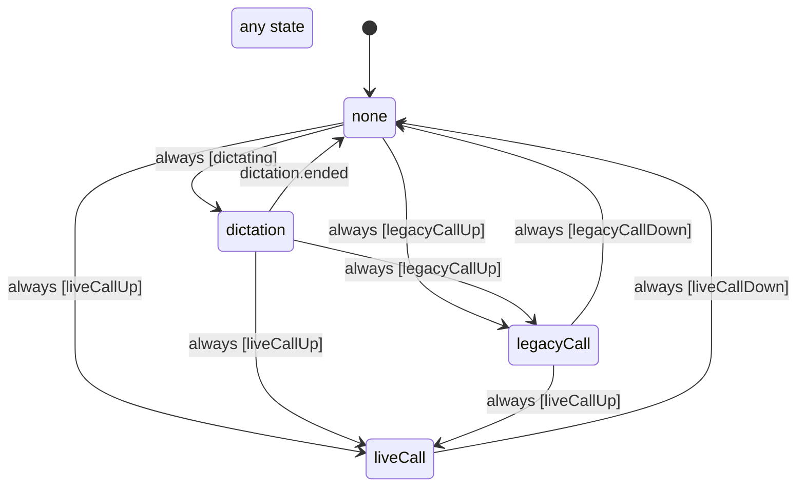

# Audio session owner (dictation, legacy call, live call)

Who owns the phone's audio session, so a dictation that ends never pulls the session out from under a call. Claims rank live call, then legacy call, then dictation; the highest claim that is up owns the session.

- `none`: nobody is recording; the session is left alone.
- `dictation`: Apple's recognizer took the session (playAndRecord, active). Only `dictation.ended` here hands it back as playback, deactivated.
- `legacyCall`: a call over the socket runs on the session. A dictation ending meanwhile only drops its claim; if it is still running when the call ends, it owns the session again.
- `liveCall`: the native live call (Action Button or the thread) runs on the session and outranks every other claim; the phone mirrors it from the live call store.

<!-- diagram:start (generated from the machine by `pnpm machines:docs`; do not edit) -->

<!-- diagram:end -->
