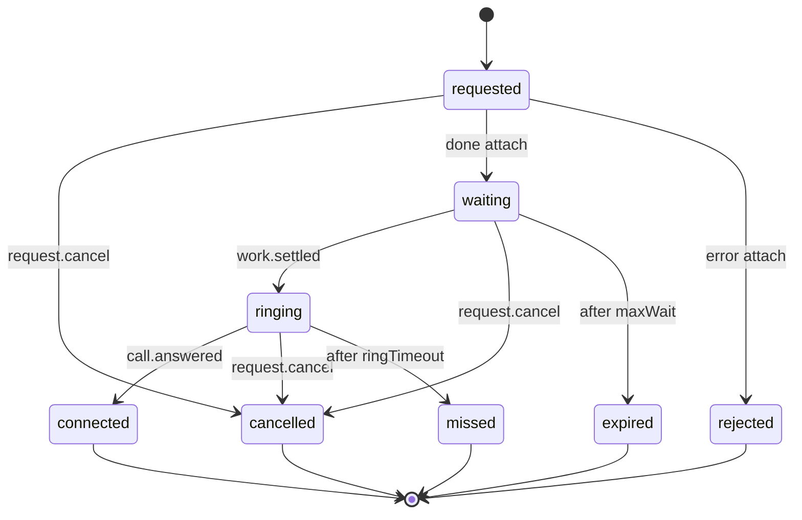

# Call me when it's done (host)

Isaac asked an assistant to call him when some work is done ("Nova, call me when the waterfall options are ready"); the assistant registered it with `relay-host call-me add`. One request runs this machine (`apps/linux/src/callme/callRequest.machine.ts`), driven by `CallMeService` (`callme/service.ts`), which provides the effects: the thread card, the pushes and the work watchers. Only Isaac's ask creates one; nothing here starts a call on its own. Timing comes from host.json `callMe` (`ringMs`, `maxWaitMs`, `pollMs`), defaults in `DEFAULT_CALL_ME_TIMING`.

- `requested`: the host checks that the named work exists (an agent-session run, an omp session, or `manual`). The CLI gets its answer when this state is left.
- `rejected`: the work was not found. Final, silent: the CLI reports the reason and nothing shows in the thread.
- `waiting`: a work card "Call you when done: <work>" sits in the assistant's thread while the watcher follows the work. A run's record is read every `pollMs`; a session is checked on each session change (settled once it is not working and none of its background jobs or subagents run).
- `ringing`: the work settled, finished or failed. Isaac's phones get a Time Sensitive "<assistant> is calling" push; its tap opens the call with `call.start` + `request`, whose greeting names the work and says whether it finished. Failed work rings too.
- `connected`: Isaac answered. Final; the call itself is the Deepgram (or local) call's own lifecycle.
- `missed`: nobody answered within `ringMs`. Final: the ring is withdrawn, one "Missed call from <assistant>" push goes out and the card shows the result. No retry.
- `cancelled`: Isaac said never mind (the assistant ran `call-me cancel`). Final; a ringing push is withdrawn.
- `expired`: the work never settled within `maxWaitMs`. Final; the card says so, no call.

<!-- diagram:start (generated from the machine by `pnpm machines:docs`; do not edit) -->

<!-- diagram:end -->
