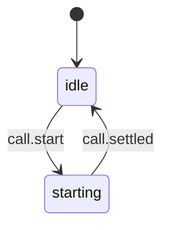

# Call button start guard

Source: `apps/mobile/src/call/callStart.machine.ts`; `startVoiceCall` in `apps/mobile/src/call/live.ts` drives it.

- **idle**: no Call button start is running; a tap starts a call.
- **starting**: a call (live, or the legacy fallback) is starting; more taps do nothing, so rapid taps start one call. It goes back to idle once that start came out, whatever the outcome.

<!-- diagram:start (generated from the machine by `pnpm machines:docs`; do not edit) -->

<!-- diagram:end -->
