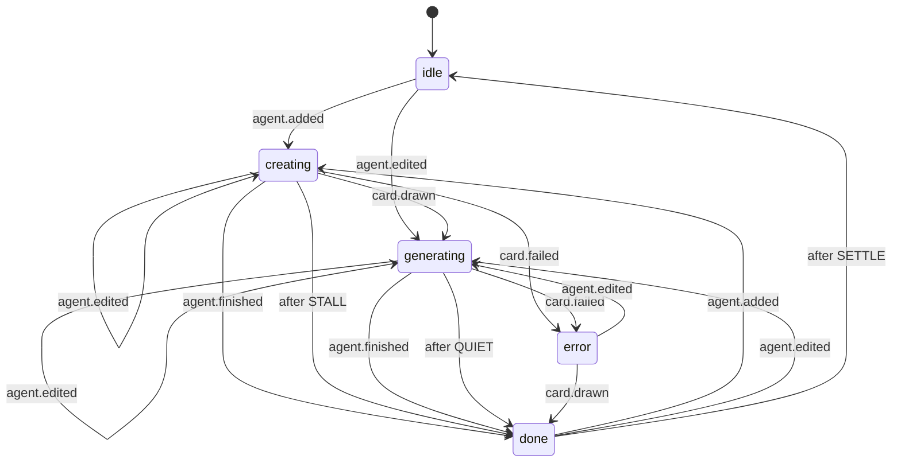

# Card generation states on the canvas (desktop)

What a component card or frame shows while an agent makes it, after pen.dev (`apps/desktop/src/renderer/canvas/agent/card-gen.machine.ts`, one actor per card held by `card-gen.ts`). The canvas drive in main sends board call `gen` when the agent's `canvas.add` lands a card (`agent.added`) and when its `canvas.edit` changes one or `canvas.add` puts a card into a frame (`agent.edited`); the agent's run on the board leaving `working` (canvas.done, stopped, idle, Isaac taking over) sends `agent.finished`. The card itself says when its content drew: a component card's page drew its code (`card.drawn`) or did not (`card.failed`), a frame got its first card.

- **idle**: nobody is making the card; it looks as it always does. Draws and failures change nothing here (the card's own error bar still shows a broken render).
- **creating**: the agent just added it and nothing drew yet: an accent-bordered empty frame with a centered spinner (the booting page blurred under it), "Creating: board • title" over it, and a spinner ring at the agent's cursor tip. A card that never draws stops after `STALL` (20 s).
- **generating**: the agent is writing it: "Generating: board • title" in the accent, an accent border and a soft light drifting across the frame (transform only, still when motion is off or reduced). Each edit restarts `QUIET` (30 s); a quiet spell that long counts as done.
- **error**: its newest code did not draw while the agent worked: the label and border turn the danger color and the card keeps its last good render. The agent's next edit is another try; a later draw (an undo, a fix) makes it done. The run ending does not clear it.
- **done**: the label goes plain ("board • title", muted) and the light fades out; after `SETTLE` (4 s) the card is idle again.

<!-- diagram:start (generated from the machine by `pnpm machines:docs`; do not edit) -->

<!-- diagram:end -->
