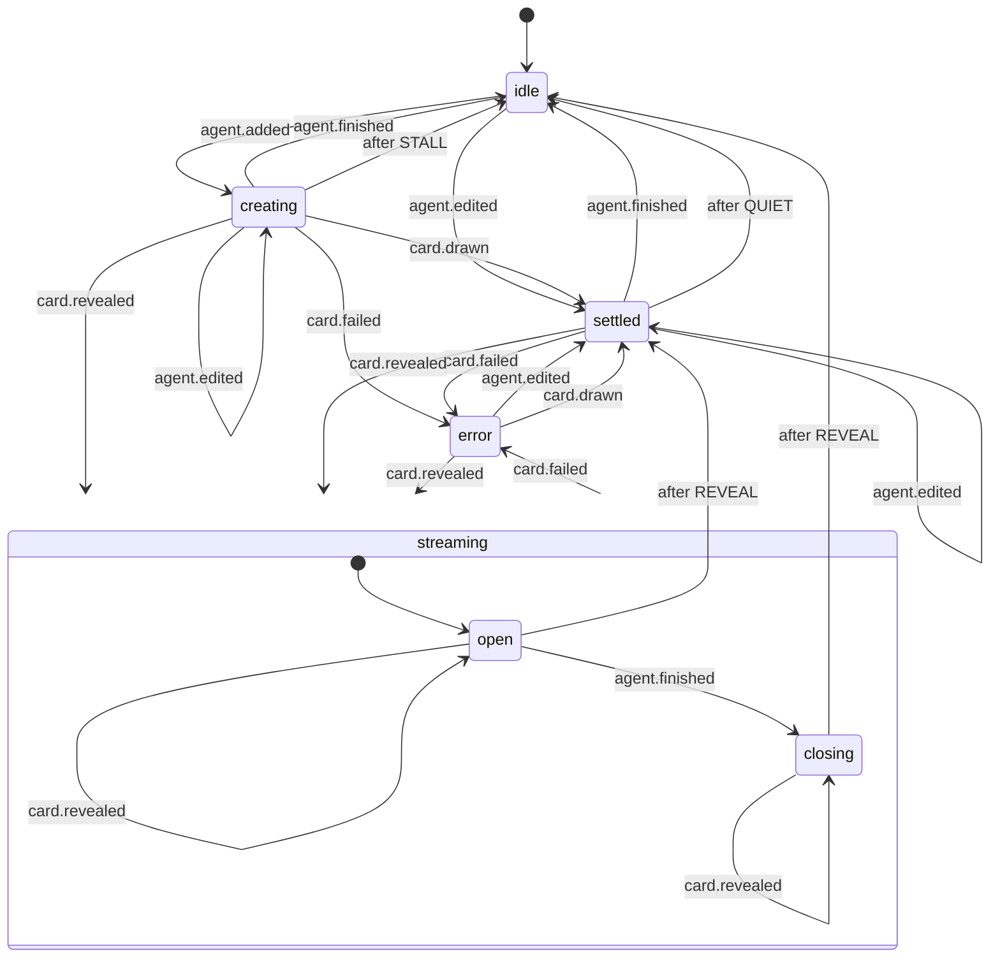

# Card generation states on the canvas (desktop)

What a component card or frame shows while an agent makes it, after pen.dev (`apps/desktop/src/renderer/canvas/agent/card-gen.machine.ts`, one actor per card held by `card-gen.ts`). The canvas drive in main sends board call `gen` when the agent's `canvas.add` lands a card (`agent.added`) and when its `canvas.edit` changes one or `canvas.add` puts a card into a frame (`agent.edited`); the agent's run on the board leaving `working` (canvas.done, stopped, idle, Isaac taking over) sends `agent.finished`. The card itself says when content arrives: a component card's page streams in what a revision added or changed (`packages/widget-runtime/src/runtime/stream.ts`) and answers how long that runs (`card.revealed`, also sent to the frame the card sits in), drew with nothing to stream (`card.drawn`) or did not draw (`card.failed`); a frame streams when a card lands in it.

- **idle**: nobody is making the card; it looks as it always does. Draws, reveals and failures change nothing here (the card's own error bar still shows a broken render).
- **creating**: the agent just added it and nothing drew yet: an accent-bordered empty frame with a centered spinner (the booting page blurred under it), "Creating: board • title" over it, and a spinner ring at the agent's cursor tip. A card that never draws stops after `STALL` (20 s).
- **streaming**: content is arriving: "Generating: board • title" in the accent, an accent border and a soft light drifting across the frame (transform only), while the page's elements fade and rise in one by one. It lasts the reveal (at least 600 ms) plus a 600 ms tail (`REVEAL`); a reveal landing meanwhile extends it. `open` returns to settled; `closing` (the run ended mid-reveal) finishes the reveal, then idle. Motion off or reduced: the page swaps at once and only the label shows.
- **settled**: the agent still has the card but nothing is arriving: it looks as it always does (the light fades out and stops), however long the run stays open. Each edit restarts `QUIET` (30 s); a quiet spell that long, or the run ending, makes it idle.
- **error**: its newest code did not draw while the agent worked: the label and border turn the danger color and the card keeps its last good render. The agent's next edit is another try; a later draw (an undo, a fix) settles it. The run ending does not clear it.

<!-- diagram:start (generated from the machine by `pnpm machines:docs`; do not edit) -->

<!-- diagram:end -->
