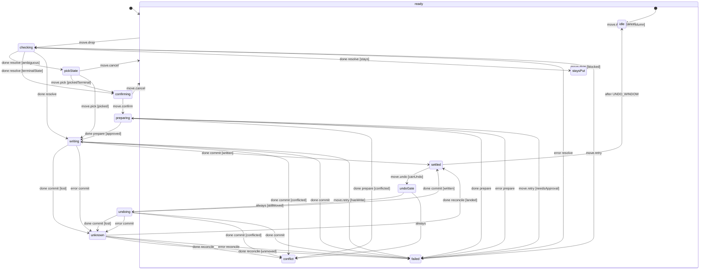

# Dragging a Board card to another column (desktop)

One card dragged to another Board column (`apps/desktop/src/renderer/agents-board/card-move.machine.ts`, run by `useCardMove()` in `card-move-actor.ts`). The column becomes one of the team's Linear states, written by the host's write gate as Isaac; the board only offers moves that will stick, Done and Canceled are confirmed, and a write whose answer was lost is checked, never sent again on its own. One move at a time.

- **ready**: nothing in flight; a drop starts a move, and dismisses the last one's message.
  - **idle**: no move.
  - **staysPut**: the drop was refused before anything was written: an agent drives the card (its column follows the run), it has no Linear issue, writes are off, no state matches the column, or the board would put it straight back ("This card stays in In review: PR #9 is open").
  - **settled**: Linear has the new state; the card shows in its new column and Undo is offered for `UNDO_WINDOW` (8 s). No Undo of an Undo, or of a move out of Done or Canceled.
  - **undoGate**: Undo only while the card is still in the state it was moved to; else it says Linear changed and writes nothing.
  - **conflict**: the host refused because the ticket changed in Linear since the board read it; the card goes back to its column.
  - **failed**: the move didn't happen (the gate refused, Linear failed, or it didn't land); the card goes back. Retry sends the same write with the same opId (Done and Canceled ask the gate for a new approval first).
- **checking**: finding the team's state for the column and whether the move would stick.
- **pickState**: several states match the column; the status picker asks which.
- **confirming**: Done or Canceled waits on Isaac's confirm.
- **preparing**: the host's gate approves the confirmed move.
- **writing** / **undoing**: the move (or its swapped Undo, with a new opId) is being written; the card shows in its new column meanwhile.
- **unknown**: the answer was lost; the board says "Checking whether it moved" and reads the ticket's state: moved means settled, unmoved means failed (Retry is safe: the host dedupes the opId), anything else is a conflict.

<!-- diagram:start (generated from the machine by `pnpm machines:docs`; do not edit) -->

<!-- diagram:end -->
