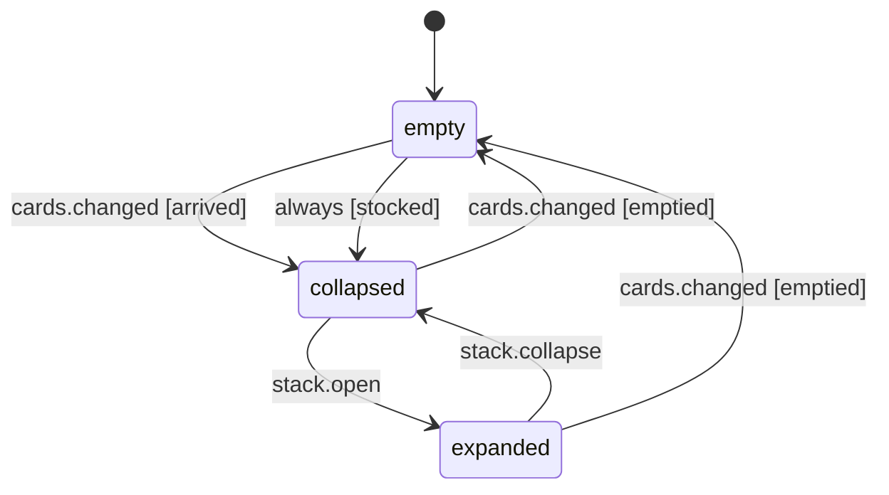

# Card stack on the composer: asks and running sessions (desktop)

One stack of cards on the chat's composer: what needs Isaac (open asks, the session's question or approval) first, then what runs for the chat (its subagents and the sessions its assistant started). The machine keeps only the cards' ids in order and which one is in front; the cards come from the chat's data.

- `empty`: no card, so no tab on the composer.
- `collapsed`: the tab on the composer shows the front card's title. Clicking it opens the stack; nothing can step while closed.
- `expanded`: the front card has grown up out of the tab. The dots under it pick a card (no wrap past the ends); collapse or a click outside closes it. A card that leaves (answered here, or resolved in the chat) hands the front to the next card that stayed, and the last one leaving empties the stack.

<!-- diagram:start (generated from the machine by `pnpm machines:docs`; do not edit) -->

<!-- diagram:end -->
