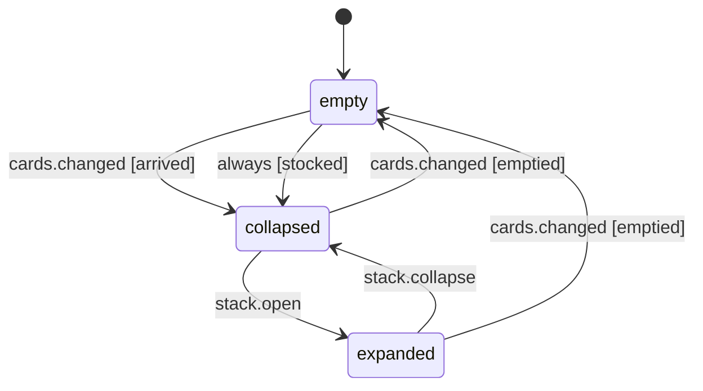

# Card stack on the composer: asks and running sessions (phone)

One stack of cards on the assistant thread's composer: what needs Isaac (open asks, the session's ask card or approval) first, then what runs for the thread. The machine keeps only the cards' ids in order and which one is in front; the cards come from the thread's data.

- `empty`: no card, so no tab on the composer.
- `collapsed`: the tab on the composer shows the front card's title. Tapping it opens the stack; nothing can step while closed.
- `expanded`: the cards have risen to the middle of the screen as a carousel. A swipe steps one card either way and wraps past the ends; tapping outside or swiping down collapses it. A card that leaves (answered here, or resolved in the chat) hands the front to the next card that stayed, and the last one leaving empties the stack.

<!-- diagram:start (generated from the machine by `pnpm machines:docs`; do not edit) -->

<!-- diagram:end -->
