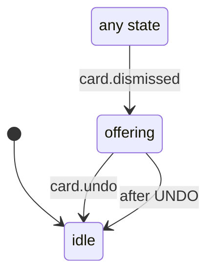

# Undo toast after dismissing a status card

What the Undo toast does after a status card (a canvas Join, a work, meeting, sign-in or room card) is dismissed. The dismissal itself is applied at once by `state/dismissedCards`; this machine only shows the offer to take it back and for how long.

- `idle`: no offer on screen.
- `offering`: the toast says what was dismissed and offers Undo for four seconds. Undo restores exactly that dismissal and ends the offer; the timer ending it leaves the card dismissed. A second dismissal in this state replaces the offer and restarts the four seconds (the first card stays dismissed but can no longer be undone from the toast).

<!-- diagram:start (generated from the machine by `pnpm machines:docs`; do not edit) -->

<!-- diagram:end -->
