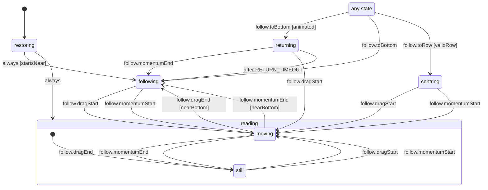

# Inverted chat follow

Whether a chat transcript (inverted list) keeps the newest row in view (`apps/mobile/src/ui/chatFollow.machine.ts`, run by `useInvertedChatScroll`). `following` pins the list to the bottom as rows arrive; `restoring` picks that or `reading` from where the thread was left. Only a gesture leaves it: `reading.moving` is a finger or the flick after it, and where it ends decides between following again (near the bottom) and `reading.still`.

`returning` is the animated trip home after the scroll-to-bottom button; it ends on the scroll's end event, or after `RETURN_TIMEOUT` when no event comes (the list was already at the bottom). `centring` scrolls a chosen row to the middle and stays a reader until the next gesture.

<!-- diagram:start (generated from the machine by `pnpm machines:docs`; do not edit) -->

<!-- diagram:end -->
