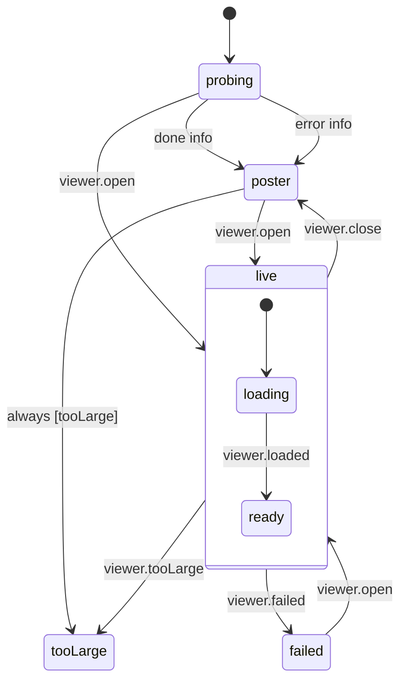

# Chat 3D model, poster until clicked (desktop)

One openui Model block in a desktop chat (`apps/desktop/src/renderer/chat/widgets/rich/model-viewer.machine.ts`, run by `useModelViewer` in `model-viewer.ts`). Opening a chat downloads no model and creates no WebGL context: every block is a poster until Isaac clicks it, and only one model is open in the whole app (`open-model.ts`). Before this, every model near the viewport loaded by itself, and a thread with several 10 to 20 MB scans crashed Relay (2026-11-22).

- **probing**: asks main for the file's size and name (`relay-media://info/`, a HEAD to the host, nothing downloaded). A click does not wait for it.
- **poster**: the file's name, size and "Click to view in 3D".
- **live.loading**: the `scene` actor downloads the GLB (refusing it once it passes `MODEL_MAX_BYTES`, 40 MB), then creates the WebGL context and parses it; `away` watches the frame. Entering `live` closes the model open before (`claim`).
- **live.ready**: drawn, with the 3D tag. Leaving `live` for any reason (another model opened, scrolled more than 1200 px away, the chat unmounted) stops `scene`, which disposes geometry, materials, textures and the WebGL context.
- **failed**: the load failed; the poster says why and a click tries again.
- **tooLarge**: over the limit (from the size probe or the download); says so and never opens.

<!-- diagram:start (generated from the machine by `pnpm machines:docs`; do not edit) -->

<!-- diagram:end -->
