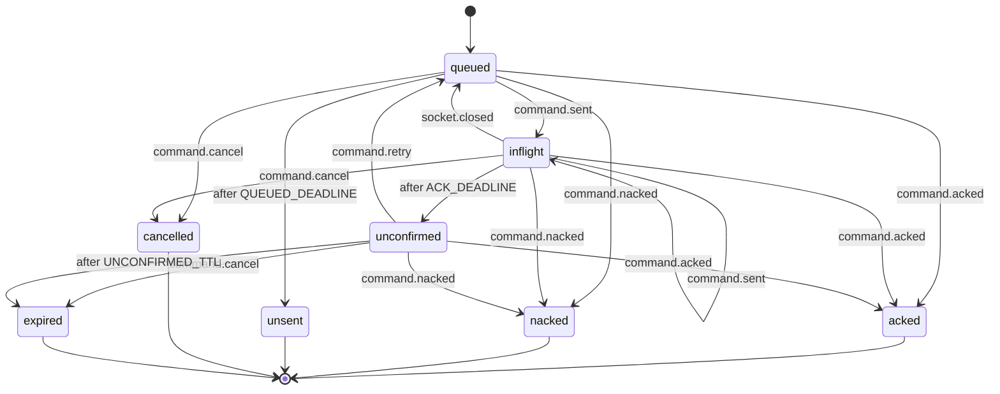

# Reliable command lifecycle (phone to host)

One reliable command the phone sends to the host (`apps/mobile/src/connection/command.machine.ts`, one actor per command id, run by `commands.ts` `CommandQueue`). A timeout is an unknown outcome, never a failure: the host may still be running the command, so it is kept and a late ack still counts.

- `queued`: not on the wire of a live socket (no socket yet, or the one it went out on closed). No ack deadline runs here; only the longer never-sent deadline, which ends in `unsent`, a real failure.
- `inflight`: on the wire; the host owes an ack within the ack deadline (10 s, 45 s for a turn, 70 s for a sign-in). Sending it again on a new socket restarts the deadline.
- `unconfirmed`: the ack deadline passed while it was on the wire. The caller's promise rejects with `timeout`, but a late ack or nack still settles it and is reported (`onCommandReport`). A retry (the same turn `clientId` sent again) puts it back on the wire with the same id, which the host dedups. Forgotten (`expired`) after ten minutes with no word.
- `acked`, `nacked`, `unsent`, `cancelled` (switched hosts): settled, and the record is dropped.

<!-- diagram:start (generated from the machine by `pnpm machines:docs`; do not edit) -->

<!-- diagram:end -->
