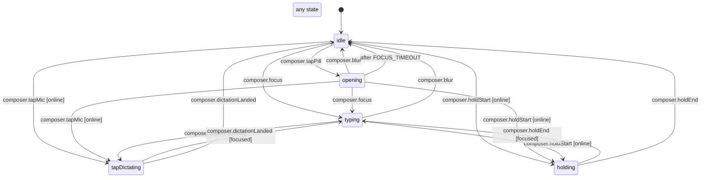

# Composer shape (pill, card, dictation, hold)

The assistant thread's composer (`apps/mobile/src/agents/composerShape.machine.ts`, run by `AssistantComposer`). `idle` is the floating pill; `opening` is the card rising with the keyboard before the field reports focus, and it falls back to the pill if the focus never comes (`FOCUS_TIMEOUT`), so the card never sits open with no keyboard. `typing` has the keyboard up.

`tapDictating` fills the field with live words after a mic tap; keys wait until it lands, then the field is the draft again (typing if the keyboard is still up). `holding` is a walkie-talkie hold on the pill or the mic. Being offline only stops the mic and the hold (`online`); the field stays editable. Any state but `idle` counts as busy for the OTA gate.

<!-- diagram:start (generated from the machine by `pnpm machines:docs`; do not edit) -->

<!-- diagram:end -->
