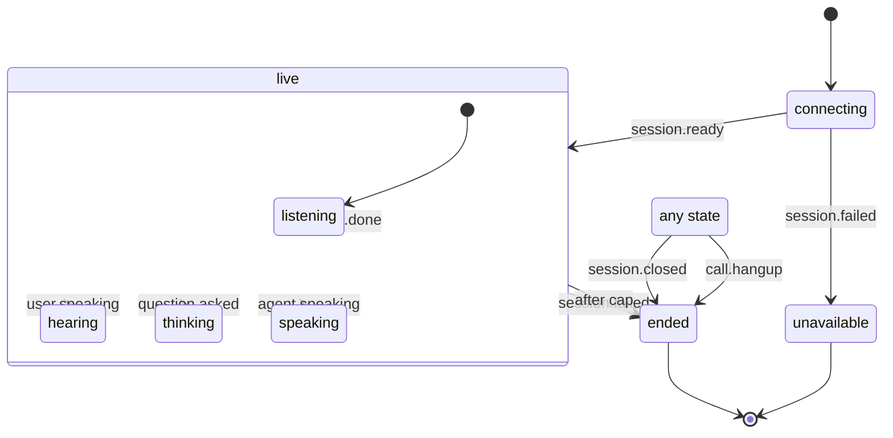

# Deepgram Voice Agent call (host)

One phone call to an assistant served by a Deepgram Voice Agent session (`apps/linux/src/call/deepgramCall.machine.ts`, run by `deepgramCall.ts` for `CallService` when the host's voice engine is Deepgram). The machine owns the lifecycle and what the phone is shown; the session actor and the thread bridge are provided by the runtime. Leaving the machine stops the session actor, which closes the Deepgram socket once.

- `connecting`: the session is opening (`Settings` sent, waiting for `SettingsApplied`). The phone has been sent nothing yet.
- `unavailable`: the session never opened (no key, refused, timed out). Final, silent: `CallService` falls back to the local call.
- `live`: the session is open and the call can end only through `ended`. Inside it:
  - `listening`: waiting for Isaac.
  - `hearing`: Isaac is speaking (also entered when he talks over the agent, which stops playback).
  - `thinking`: the agent handed a question to the assistant thread and is waiting for its reply.
  - `speaking`: the agent is speaking.
- `ended`: final. Reached by the phone hanging up, the socket or provider dropping, a provider error after start, or the 30 minute cap (`MAX_LIVE_CALL_MS`). A hang-up while still `connecting` also lands here.

<!-- diagram:start (generated from the machine by `pnpm machines:docs`; do not edit) -->

<!-- diagram:end -->
