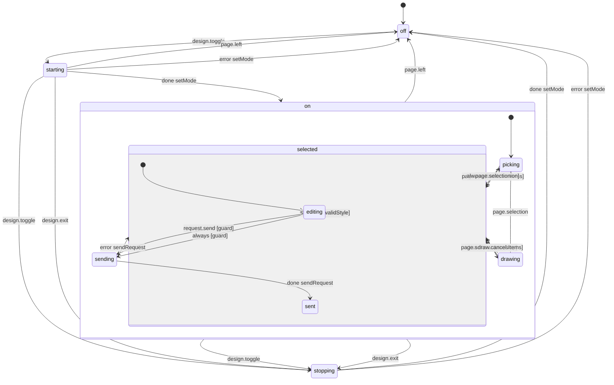

# Design Mode in a page tab (desktop)

Design Mode in one page tab of Relay Desktop (`apps/desktop/src/renderer/browser/design/design-mode.machine.ts`, run per tab by `design-runtime.ts`; the page side is `apps/desktop/src/main/browser/design-mode.ts`). `starting` and `stopping` ask main to turn the in-page highlight and input capture on or off; a page main can't reach goes back to `off` with the reason. Main's events come in as `page.selection` (a click, or the page changing the selection itself), `design.exit` (Escape, from the page or the inspector) and `page.left` (the tab went to another site or closed, so main already ended it).

- **picking**: on, nothing selected yet; hovering highlights, a click selects.
- **selected.editing**: the inspector shows the selection; Isaac types a change, edits a style value (previewed in the page) or opens a crop to draw on. Send needs at least one element that is in the page and a change, a style edit or a drawing.
- **drawing**: one element's crop is open to draw on; Done puts the drawing in place of that crop in the request.
- **sending**: the prompt goes to the workspace's chat, once; a failure goes back to editing with the request intact.
- **selected.sent**: it went; the selection stays and follows the page as the agent's edit hot-reloads it. Any new change goes back to editing.

<!-- diagram:start (generated from the machine by `pnpm machines:docs`; do not edit) -->

<!-- diagram:end -->
