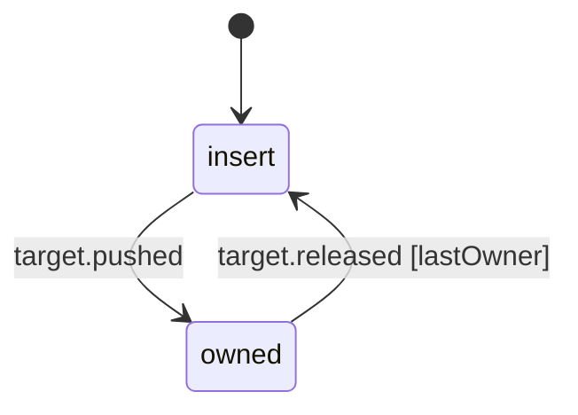

# Dictation target owner stack

Where hold-to-talk sends its words. Each screen that points dictation somewhere pushes its own entry while it has focus and releases only that entry when it leaves, so the next screen's focus landing before the previous screen's blur no longer matters. The newest entry still held is the target.

- `insert`: nobody holds dictation; the words are typed into the Mac's focused app (plus Return on a submit).
- `owned`: at least one screen holds an entry (a thread, an agent session, a meeting's Ask). Releasing an entry twice, or one already gone, changes nothing.

<!-- diagram:start (generated from the machine by `pnpm machines:docs`; do not edit) -->

<!-- diagram:end -->
