# Dictation (hold-to-talk and tap runs)

The phone's one dictation, in three regions that run side by side.

- `speech` is the pipeline: asking for the microphone, `listening` while the finger is down, `finishing` while the recognizer hands over its last words, then `sending` them to wherever the screen points dictation and `sent` (the check), or `error`. A swipe left while listening opens the skill wheel (`choosing`, `chosen`) and arms a command for the next hold.
- `orb` is the centered orb: `shown` while listening, `lifted` once the finger crossed the send threshold, `flying` off the top after a submit, `collapsing` into the check, `fading` out, `gone` until speech is idle again.
- `tap` is a composer's tap-to-dictate run: `running` while the field shows the draft plus the words so far, `landing` once stop, send or the x was pressed. When speech settles the run lands exactly once in its own composer (the draft, or one sent turn), never through the screen's target.

```mermaid
stateDiagram-v2
  state "any state" as anyState
  state "dictation (all regions)" as root
  state root {
    state speech {
      [*] --> speech_idle
      state "idle" as speech_idle
      state "requesting_permission" as speech_requesting_permission
      state "permission_denied" as speech_permission_denied
      state "active" as speech_active
      state speech_active {
        [*] --> speech_active_listening
        state "listening" as speech_active_listening
        state "finishing" as speech_active_finishing
      }
      state "choosing" as speech_choosing
      state "chosen" as speech_chosen
      state "finished" as speech_finished
      state "sending" as speech_sending
      state "sent" as speech_sent
      state "error" as speech_error
    }
    --
    state orb {
      [*] --> orb_hidden
      state "hidden" as orb_hidden
      state "shown" as orb_shown
      state "lifted" as orb_lifted
      state "flying" as orb_flying
      state "collapsing" as orb_collapsing
      state "fading" as orb_fading
      state "gone" as orb_gone
    }
    --
    state tap {
      [*] --> tap_off
      state "off" as tap_off
      state "running" as tap_running
      state "landing" as tap_landing
    }
  }
  anyState --> speech_idle : reset
  anyState --> tap_off : reset
  speech_idle --> speech_requesting_permission : pressStart
  speech_idle --> speech_sending : sendAttachments [hasAttachments]
  speech_idle --> speech_sending : typed [guard]
  speech_requesting_permission --> speech_active : done checkPermission [guard]
  speech_requesting_permission --> speech_permission_denied : done checkPermission [guard]
  speech_requesting_permission --> speech_error : done checkPermission
  speech_requesting_permission --> speech_error : error checkPermission
  speech_permission_denied --> speech_requesting_permission : pressStart
  speech_active --> speech_finished : recognizerError [noSpeech]
  speech_active --> speech_error : recognizerError
  speech_active_listening --> speech_active_finishing : pressStop
  speech_active_listening --> speech_active_finishing : release
  speech_active_listening --> speech_choosing : wheelOpen
  speech_active_listening --> speech_idle : abandon
  speech_active_listening --> speech_idle : tapEnd [tapDropped]
  speech_active_listening --> speech_active_finishing : tapEnd [tapRunning]
  speech_active_listening --> speech_active_finishing : launch
  speech_active_listening --> speech_active_finishing : pressStart
  speech_active_listening --> speech_error : recognizerEnd
  speech_active_listening --> speech_active_finishing : always [released]
  speech_active_finishing --> speech_finished : final
  speech_active_finishing --> speech_finished : recognizerEnd
  speech_active_finishing --> speech_finished : after FINISH_TIMEOUT
  speech_choosing --> speech_sending : wheelSelect [guard]
  speech_choosing --> speech_chosen : wheelSelect
  speech_choosing --> speech_idle : release
  speech_choosing --> speech_idle : wheelClose
  speech_choosing --> speech_idle : pressStart
  speech_chosen --> speech_idle : release
  speech_chosen --> speech_idle : pressStart
  speech_finished --> speech_sent : always [tapHeard]
  speech_finished --> speech_sending : always [hasText]
  speech_finished --> speech_sending : always [launching]
  speech_finished --> speech_idle : always
  speech_sending --> speech_sent : done deliver
  speech_sending --> speech_error : error deliver
  speech_sent --> speech_idle : after SENT_HOLD
  speech_error --> speech_requesting_permission : pressStart
  speech_error --> speech_idle : after ERROR_HOLD
  orb_hidden --> orb_shown : always [speechActive]
  orb_shown --> orb_lifted : pressStop [and]
  orb_shown --> orb_flying : launch [listening]
  orb_shown --> orb_collapsing : always [speechSent]
  orb_shown --> orb_fading : always [speechIdle]
  orb_shown --> orb_fading : always [speechError]
  orb_shown --> orb_fading : always [speechChoosing]
  orb_lifted --> orb_fading : release [speechIdle]
  orb_lifted --> orb_fading : release [speechError]
  orb_lifted --> orb_flying : release
  orb_flying --> orb_gone : after ORB_FLIGHT
  orb_collapsing --> orb_fading : always [speechIdle]
  orb_fading --> orb_hidden : after ORB_FADE
  orb_fading --> orb_shown : always [speechActive]
  orb_gone --> orb_hidden : always [speechIdle]
  tap_off --> tap_running : tapBegin [tapCanBegin]
  tap_running --> tap_landing : tapEnd
  tap_running --> tap_off : always [speechSent]
  tap_running --> tap_off : always [speechSettled]
  tap_landing --> tap_off : always [speechSent]
  tap_landing --> tap_off : always [speechSettled]
```

<!-- diagram:start (generated from the machine by `pnpm machines:docs`; do not edit) -->

<!-- diagram:end -->
