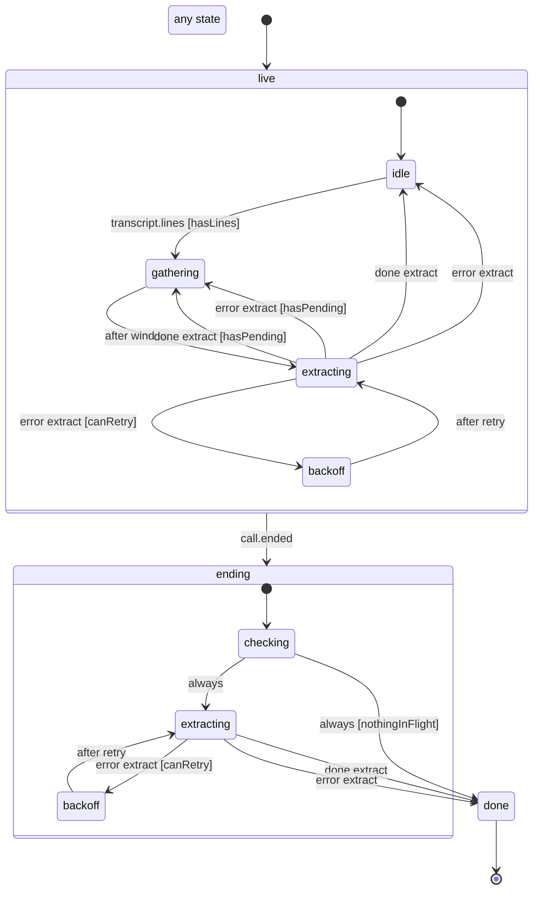

# Key moments of a live call (host)

The key moments of one live recording on the host (`apps/linux/src/meetings/key-moments.machine.ts`, driven by `key-moments.ts` from `MeetingsService`): decisions, asks of Isaac, actions and notable claims, found by Claude Haiku a window of transcript at a time and kept in the recording's `moments.json`. It ends `done` once the call has ended and the last lines were looked at; its output is the moments, which the after-call notes list under `## Key Moments`.

- `idle`: every final line so far has been looked at; the next one opens a window.
- `gathering`: a window is open for 45 s from its first line, collecting the lines said meanwhile.
- `extracting`: the window's lines go to the model with the lines just before them as context and the moments found so far, so none is found twice. Lines said meanwhile wait for the next window.
- `backoff`: the model failed; it is asked again after 10 s, then 20 s. After the third failure those lines are let go.
- `ending`: the call ended; whatever is still waiting (or was being looked at) gets one last extraction, with the same retries, before `done`.
- A line the call later names (a voice gets its person) renames the moments said on it, in any state.

<!-- diagram:start (generated from the machine by `pnpm machines:docs`; do not edit) -->

<!-- diagram:end -->
