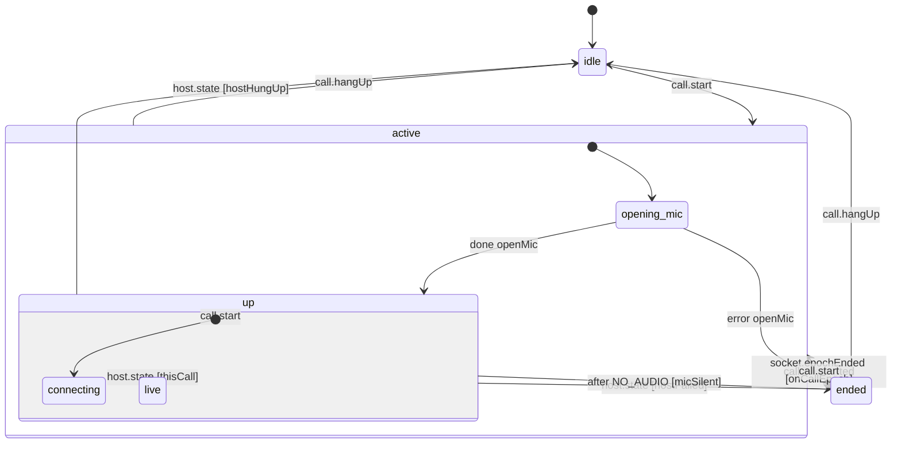

# Legacy voice call (host speech over the app socket)

A voice call where the Mac does the speech (`call.*` frames over the app's own socket, used when GPT-Live is not available). The machine decides; `call/controller.ts` runs the native audio engine and copies the machine's state into `useCallStore`, which the call screen reads (`call/legacyCall.machine.ts`).

- **idle**: no call, nothing on screen.
- **active**: the call holds the audio engine and its listeners. Hanging up, an iOS interruption, or the end of the socket the call started on (closed by either side or swapped for a new one) leaves it.
- **opening_mic**: the engine is starting. A second start now is a double tap and is ignored.
- **up**: `call.start` was sent; **connecting** until the host first answers, then **live** (listening, thinking or speaking). If the microphone sends nothing for 3 s, the call ends with that reason.
- **ended**: the call ended on an error (lost connection, host failure, deaf or failed microphone, interruption); the screen shows why until it is closed. A clean end (hang-up, or the assistant hanging up) goes straight to idle instead.

<!-- diagram:start (generated from the machine by `pnpm machines:docs`; do not edit) -->

<!-- diagram:end -->
