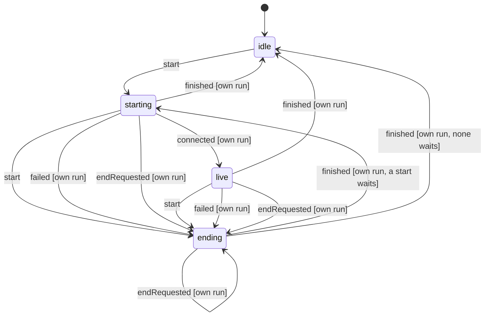

# Live call engine run lifecycle (native Swift)

Source: `apps/mobile/modules/live-call/ios/LiveCallLifecycle.swift`; LiveCallEngine applies its effects.

- **idle**: no call runs. A start begins a run at once.
- **starting**: a run is connecting (microphone, WebRTC, host link, GPT-Live); `connected` makes it live. Another start, a failure or a hang up moves it to ending, so a replaced run is always torn down.
- **live**: Isaac and the assistant are talking (LiveCallLiveness watches the connection meanwhile).
- **ending**: the run is being torn down. A start now waits here (only the newest one) and begins when the old run has finished, so the old run's audio teardown never lands under the new call; a hang up drops the waiting start. Events naming any other run are stale and change nothing.

<!-- diagram:start (generated from the machine by `pnpm test:native`; do not edit) -->

<!-- diagram:end -->
