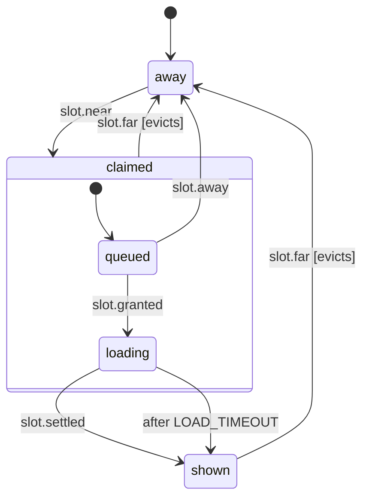

# Chat media load order (desktop)

One media element in a chat (a 3D model viewer, a widget image, a video) waiting for its turn to load (`apps/desktop/src/renderer/chat/widgets/media-slot.machine.ts`, run per element by `useMediaSlot` in `media-slot.ts`). Nothing loads until the element comes within 600 px of the visible chat; then it asks its lane's queue (`media-queue.ts`: two 3D models or four images and videos at a time) and the newest message's media go first. The `ticket` actor is that ask: leaving `claimed` releases it, so the next element starts.

- **away**: off screen, or a 3D viewer that was scrolled more than 2400 px away and gave back its WebGL context; its sized frame holds the space.
- **claimed.queued**: near the viewport, waiting for a slot; scrolling it away again drops it from the line.
- **claimed.loading**: its media loads and it holds a slot until it loaded or failed (`slot.settled`), or `LOAD_TIMEOUT` (15 s) passes.
- **shown**: loaded; a 3D viewer goes back to `away` once it is far off screen, an image or video stays.

<!-- diagram:start (generated from the machine by `pnpm machines:docs`; do not edit) -->

<!-- diagram:end -->
