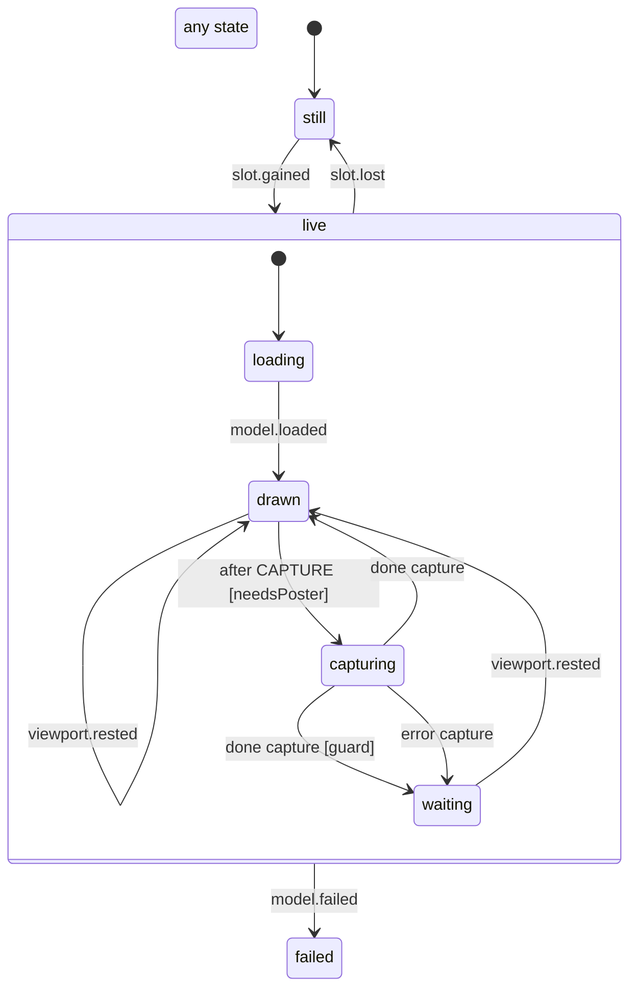

# 3D model view (live slot, poster snapshot)

One openui Model on the phone (`apps/mobile/src/ui/ModelView.tsx`). The app-wide slot (`lib/liveModel.ts`) decides which views draw a live SceneKit view: the most visible model once the transcript stops scrolling (or a tapped one while it stays on screen), plus one that is making a poster. This machine follows the slot and decides when to snapshot.

- `still`: no native view; the frame shows the model's poster (its snapshot from an earlier live turn, or the drop's own poster) or a quiet "3D model" tile. A tap asks for the slot.
- `live.loading`: the native view is mounted and downloading/reading the model; the poster stays under a spinner.
- `live.drawn`: the model is on screen. Without a poster yet, after `CAPTURE` (700 ms, so SceneKit has drawn frames) it snapshots itself. Every settle of the slot (`viewport.rested`) restarts that wait, so a view whose poster went missing tries again.
- `live.capturing`: the app's root view is snapshotted and the model's frame cropped out (`lib/modelPosters.ts`). A poster made, or a blank snapshot (the model is marked tried so the poster slot moves on), goes back to `drawn`. The guarded `done` is the capture answering `later`: the list was moving or the frame was not wholly clear of the header and composer.
- `live.waiting`: a capture said `later`; nothing polls, the next settle sends it back to `drawn` to try again.
- `failed`: the model could not load; the frame is the failure placeholder for this `src`, and it takes no slot.

Losing the slot from any `live` state unmounts the native view at once (its scene is freed), even mid-load or mid-snapshot.

<!-- diagram:start (generated from the machine by `pnpm machines:docs`; do not edit) -->

<!-- diagram:end -->
