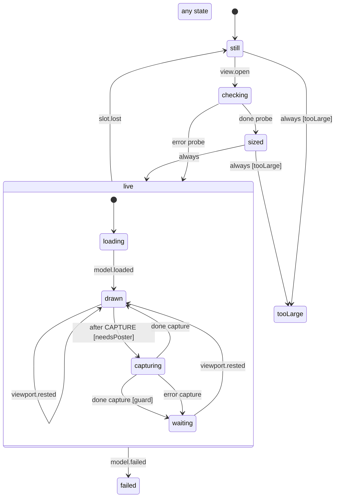

# 3D model view (live slot, poster snapshot)

One openui Model on the phone (`apps/mobile/src/ui/ModelView.tsx`). Nothing draws a live SceneKit view until Isaac taps it, and only one model is open in the app (`lib/liveModel.ts`); before this, the most visible model and a poster maker went live by themselves, and opening Nova's thread with several 5 to 20 MB scans crashed Relay (2026-11-22). This machine decides when to open, follows the slot and decides when to snapshot.

- `still`: no native view; the frame is the model's poster (its snapshot from an earlier open, or the drop's own poster) with its name, size and "Tap to view in 3D". A tap opens it.
- `checking`: a tap checks the size (`probe`: the drop's known size, else a HEAD). `sized` sends a file over `MODEL_MAX_BYTES` (40 MB) to `tooLarge`, anything else to `live`.
- `live.loading`: entering `live` takes the one open slot (`claim`), closing any other model; the native view is mounted and downloading/reading the model, the poster under a spinner.
- `live.drawn`: the model is on screen. Without a poster yet, after `CAPTURE` (700 ms, so SceneKit has drawn frames) it snapshots itself. Every settle of the slot (`viewport.rested`) restarts that wait, so a view whose poster went missing tries again.
- `live.capturing`: the app's root view is snapshotted and the model's frame cropped out (`lib/modelPosters.ts`). A poster made, or a blank snapshot, goes back to `drawn`. The guarded `done` is the capture answering `later`: the list was moving or the frame was not wholly clear of the header and composer.
- `live.waiting`: a capture said `later`; nothing polls, the next settle sends it back to `drawn` to try again.
- `failed`: the model could not load; the frame is the failure placeholder for this `src`.
- `tooLarge`: over the size limit (known up front for a drop, so it shows without a tap); says so and never opens.

Losing the slot (`slot.lost`: another model tapped, this one scrolled wholly off screen, its screen covered, unmounted) from any `live` state unmounts the native view at once (its scene is freed), even mid-load or mid-snapshot.

<!-- diagram:start (generated from the machine by `pnpm machines:docs`; do not edit) -->

<!-- diagram:end -->
