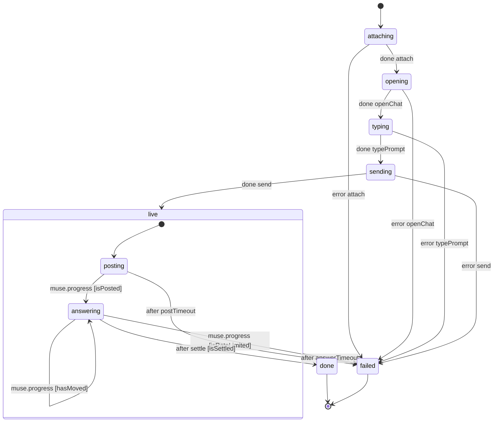

# One question to Muse's desktop app (web-researcher's Muse source)

One question from the web-researcher chef to Meta's Muse desktop app, signed in as Isaac (`packages/atomic-agents/src/adapters/research/muse/ask.machine.ts`, driven by `muse/driver.ts` over cua-driver in the background). It ends `done` with Muse's answer and links, or `failed` with a kind (unavailable, signed out, busy, UI changed, rate limited, timeout) the researcher reports before falling back to agent-reach.

- `attaching`: Muse is launched in the background if needed, must be signed in and not the app in front (Isaac using it), and its window is parked in the screen's bottom-right corner.
- `opening`: presses New side chat and waits for an empty chat with a composer.
- `typing` / `sending`: the question goes in as keyboard events to Muse's process (one line, since Return sends), then one Return.
- `live`: a watcher reads the window every 2.5 s; Muse has 6 minutes in all to finish.
- `posting`: waits up to 20 s for the question to show up as Isaac's message; if it never does, the composer did not take it.
- `answering`: every change, and every read while the composer still offers Stop, restarts a 6 s settle wait; an answer that holds still with Send back is done. An answer that is a rate-limit or message-cap notice fails as rate limited.

<!-- diagram:start (generated from the machine by `pnpm machines:docs`; do not edit) -->

<!-- diagram:end -->
