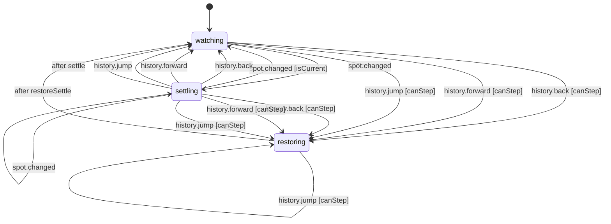

# The window's Back and Forward history (desktop)

The whole window's Back and Forward, like a browser's (`packages/shell-core/src/nav-history.machine.ts`, run by `apps/desktop/src/renderer/navigation/nav-history.ts`). Each entry is a spot: the workspace, the app tab in front and what it shows (chat, assistant, Settings section, Reviews item, board, workspace), and the tool tab that held the focus. Up to 100 entries are kept. The first spot and any spot that stays 0.15 s are recorded; a repeat of the current spot only refreshes it (a chat's scroll).

- `watching`: nothing pending. A change of spot starts `settling`; Back, Forward and the history list's jump start `restoring`.
- `settling`: a change was seen but is not an entry yet. Another change inside 0.15 s replaces it (tab flicker records nothing); coming back to the current spot records nothing. A step does not wait: the pending spot is recorded first, so Back returns to where Isaac was.
- `restoring`: the screen is being put back at an entry. For 0.3 s every spot seen is the echo of that step and records nothing (so Forward survives); another step in that time goes on from here. If the step landed somewhere else (its tab was closed), the entry takes that place.
- A new place after stepping back drops the entries forward of it, as in a browser.

<!-- diagram:start (generated from the machine by `pnpm machines:docs`; do not edit) -->

<!-- diagram:end -->
