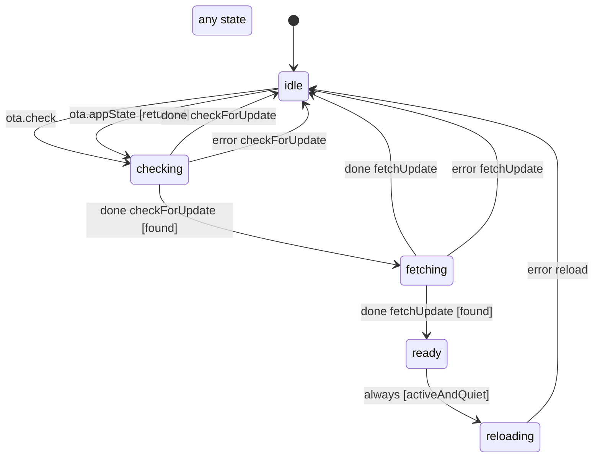

# OTA reload gate

Decides when the phone may restart into a downloaded JS update (`apps/mobile/src/lib/otaGate.machine.ts`, run by `otaUpdates.ts`). `idle` waits for a check: on launch, a Settings tap, or a return from the background (`returned`; a Face ID or Notification Center bounce is not one). `checking` asks the update server and `fetching` downloads the bundle; nothing new, or the server out of reach, goes back to `idle`.

`ready` holds the downloaded bundle until the app is in front and quiet (`activeAndQuiet`): no legacy or live call, no command the host has not settled, dictation at rest, every composer closed. The runtime re-sends what the guard reads whenever one of those changes, so it restarts the moment things go quiet; if they never do, expo-updates applies the bundle on the next cold start. `reloading` is the restart itself.

<!-- diagram:start (generated from the machine by `pnpm machines:docs`; do not edit) -->

<!-- diagram:end -->
