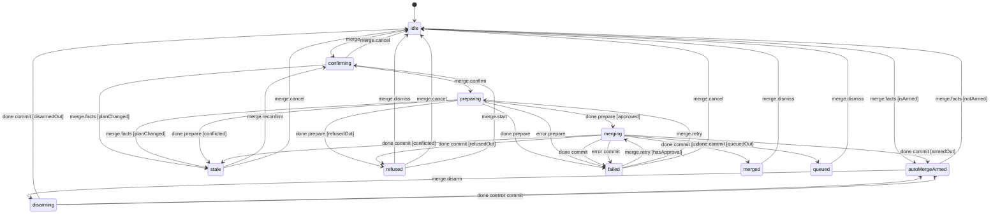

# Merging a pull request from its page (desktop)

The merge box on a PR's page (`apps/desktop/src/renderer/reviews/pr-merge.machine.ts`, run by `MergeBox.tsx`). Its one button offers the outcome GitHub's facts allow ("Merge now", "Add to merge queue" or "Turn on auto-merge"); Isaac confirms it with the repo and PR, head short SHA, base and method in view, and the host's write gate approves and writes it bound to that head (`gh pr merge --match-head-commit`, never `--admin`). The opId is minted at the confirm and reused by every retry, so a lost answer never merges twice.

- **idle**: nothing in flight; each PR read (`merge.facts`) keeps the head current, and an auto-merge already on shows as armed.
- **confirming**: the confirm is open with the exact outcome for the head Isaac saw.
- **stale**: a newer read has another head or would offer another outcome (or the host refused with `conflict`); nothing is written until Isaac confirms the new one (`merge.reconfirm`, a new opId at its confirm).
- **preparing**: the gate approves the merge for that head (single use, 120 s).
- **merging**: the write; the host reads the PR back and answers what happened.
- **merged** / **queued**: merged now, or in the merge queue.
- **autoMergeArmed**: auto-merge is on for this head (the host turns it off when new commits land); Turn off sends `autoMerge {on: false}` without a confirm.
- **disarming**: turning auto-merge off; a refusal or failure stays armed with the reason.
- **refused**: the gate said no (writes off, identity, no permission); the reason shows and nothing was written.
- **failed**: the write didn't happen or its answer was lost ("Checking whether it merged"); Retry asks again with the same opId (and the same approval when there is one).

<!-- diagram:start (generated from the machine by `pnpm machines:docs`; do not edit) -->

<!-- diagram:end -->
