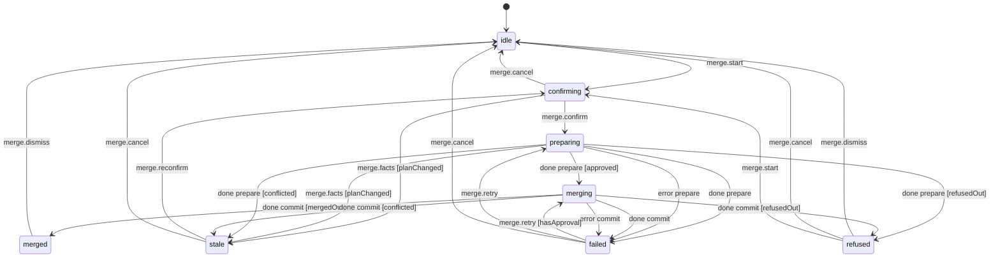

# Merging a pull request from its page (desktop)

The merge box on a PR's page (`apps/desktop/src/renderer/reviews/pr-merge.machine.ts`, run by `MergeBox.tsx`). Its one button is Merge now, offered only when GitHub would merge the PR right now; otherwise the box says why (required reviews or checks missing, behind its base, a merge queue, ...). Relay never arms auto-merge or joins a merge queue: GitHub merges those later at whatever head the PR has then, so they can't be bound to the head Isaac reviewed. Isaac confirms with the repo and PR, head short SHA, base and method in view, and the host's write gate approves it and merges exactly that head at once with GitHub's REST merge (`PUT /repos/{repo}/pulls/{n}/merge` with `sha`; never `gh pr merge`, which turns auto-merge on by itself on a queue branch, and never `--admin`). A queue, a push or anything else GitHub won't merge at that moment is its refusal: nothing is left to merge later. The opId is minted at the confirm and reused by every retry, so a lost answer never merges twice.

- **idle**: nothing in flight; each PR read (`merge.facts`) keeps the head current.
- **confirming**: the confirm is open for the head Isaac saw.
- **stale**: a newer read has another head or GitHub would no longer merge it right now (or the host refused with `conflict`: a push or a retarget); nothing is written until Isaac confirms the new one (`merge.reconfirm`, a new opId at its confirm).
- **preparing**: the gate approves the merge for that head and base (single use, 120 s).
- **merging**: the write; the host checks its GitHub sign-in again right before it, and answers merged or GitHub's refusal.
- **merged**: merged now.
- **refused**: the gate said no (writes off, identity, no permission); the reason shows and nothing was written.
- **failed**: the write didn't happen or its answer was lost ("Checking whether it merged"); Retry asks again with the same opId (and the same approval when there is one).

<!-- diagram:start (generated from the machine by `pnpm machines:docs`; do not edit) -->

<!-- diagram:end -->
