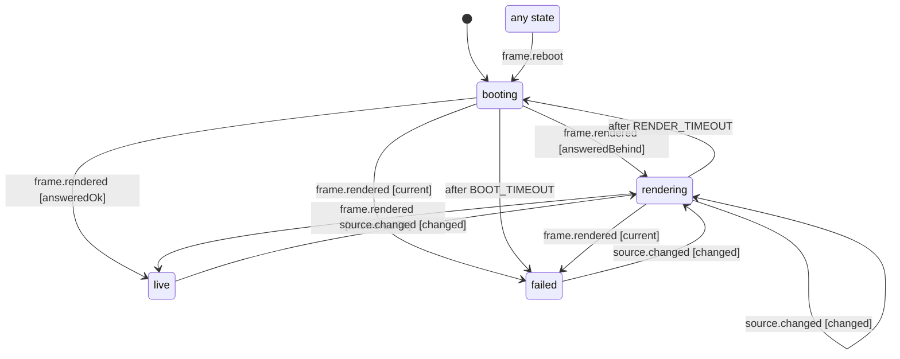

# Live component card page on the canvas (desktop)

One prototype or component card's page on the canvas (`apps/desktop/src/renderer/canvas/cards/proto-frame.machine.ts`, run per card by `ProtoCard.tsx`). The card's frame boots once with the card's code; every later edit (an agent's `canvas.edit`, an undo, a board reload) goes to the running page as a new revision over `postMessage`, so the card redraws in place without a reload. The page answers each revision with whether it drew; a revision that does not compile or throws while drawing leaves the last good render on screen and the card shows why.

- **booting**: the frame loads with `bootSource` in its URL. Edits that arrive meanwhile are remembered; once the page answers, the newest code is sent if it moved on. A page that never answers within `BOOT_TIMEOUT` (15 s) fails.
- **rendering**: revision `rev` was sent and the page is drawing it; the card dims the last render a touch and says "Redrawing". A newer edit replaces it (answers for older revisions are ignored). No answer within `RENDER_TIMEOUT` (5 s) boots a fresh page from the last good code.
- **live**: the newest code is on screen.
- **failed**: the newest code did not draw; the page shows the last good render (or the error, when nothing drew yet) and the card shows the error above it. The next edit tries again.
- **frame.reboot** (any state): the app's theme, light or dark, or the card's design system changed; a fresh page boots from the last good code, then gets the newest.

<!-- diagram:start (generated from the machine by `pnpm machines:docs`; do not edit) -->

<!-- diagram:end -->
