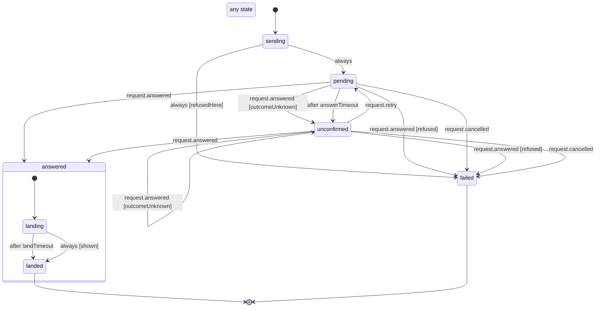

# Rooms request and card busy state

One `rooms.cmd` from the phone (post, Continue, Allow, a vote, pause ...), from `apps/mobile/src/rooms/requestMachine.ts`. A card or control holds the request of its last tap and stays busy while it is `sending`, `pending` or `answered.landing`, so a second tap cannot post or answer twice.

- **sending / pending**: a request refused on the phone (offline, a host without Rooms) fails at once; otherwise the frame went out and the phone waits for the desktop's answer.
- **unconfirmed**: no answer within 30 s (or the host said `timeout` / `device-gone`), so the desktop may have done it. The card shows "Not confirmed" with Try again, which re-sends the same rid; a late answer still settles it.
- **answered**: the desktop did it. `landing` holds the card busy until its room frame shows the change (or 15 s pass); `landed` frees it. **failed**: the desktop refused, or the socket closed before an answer (`cancelAll`).

<!-- diagram:start (generated from the machine by `pnpm machines:docs`; do not edit) -->

<!-- diagram:end -->
