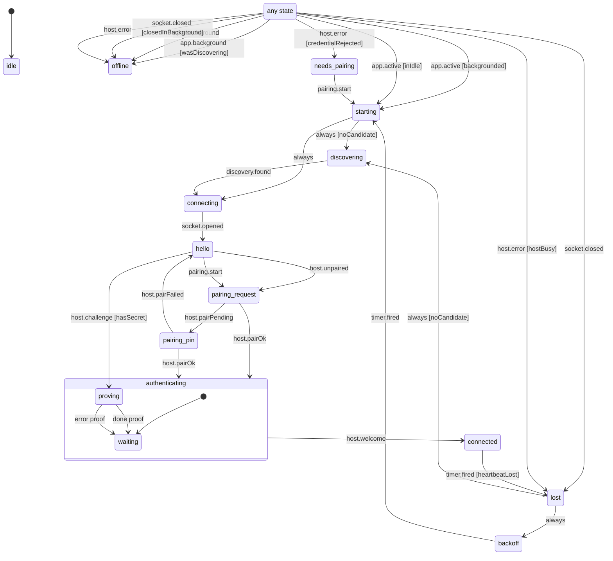

# Connection session (discovery, pairing, heartbeat, backoff, background)

The phone's connection to its Mac: find the host, say hello, pair or prove the saved secret, then stay connected with a ping every 5 seconds. The machine only decides; `connection/index.ts` opens sockets, browses Bonjour, runs the one retry timer and writes the store from the effects it emits (`connection/session.machine.ts`, driven through `connection/session.ts`).

- **idle**: nothing started yet (a fresh machine after launch or a host switch).
- **starting** and **lost**: pass-through steps. `starting` connects to the known host or discovers one; `lost` is a live connection gone (socket closed, two unanswered pings, host busy), which waits in `backoff`.
- **discovering**: browsing Bonjour (or reading a typed address) for the host.
- **connecting**, **hello**: socket opening, then hello sent and waiting for the host's challenge or "unpaired".
- **pairing_request**, **pairing_pin**: asked the host to pair; then waiting for the PIN Isaac types. **needs_pairing**: the host no longer knows this phone; nothing happens until Isaac taps Pair.
- **authenticating**: proving the secret (`proving`) or waiting for the welcome after pairing or the proof (`waiting`).
- **connected**: welcome received; heartbeat running.
- **backoff**: waiting 0.5 to 5 s before connecting again. The store says "reconnecting".
- **offline**: not trying. The app is in the background (its socket was closed on purpose; the store says "offline", never a stale "connected") or the host refused this app version.

<!-- diagram:start (generated from the machine by `pnpm machines:docs`; do not edit) -->

<!-- diagram:end -->
