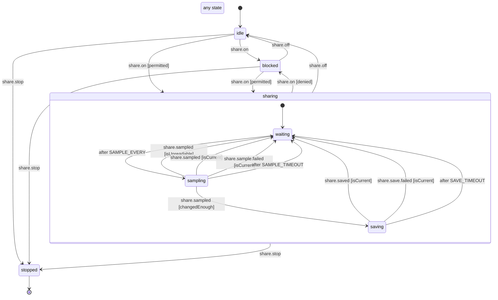

# Screen-share snapshots per recording (desktop)

When to snapshot a shared screen in one live recording (`apps/desktop/src/main/meetings/share-snapshots.machine.ts`, run per recording by `share-snapshots.ts` from `meetings-capture.ts`). The meeting helper says when someone shares and whether Relay may capture the screen; while it may, this asks it for a sample every 3 s and has it save one (OCR + JPEG) only when the sample's 256-bit hash differs from the last saved one by at least the `meetings.snapshotChange` setting (6% by default; the first sample of every share always saves). Each ask carries a `seq` and only the answer to the latest ask counts, so a late answer after a timeout is ignored. It tells the host `meeting.share` (`none`, `sharing`, `no-permission`) whenever that changes, and says `sharing` or `no-permission` again when the recording's stream to the host reconnects (a host that restarted forgot it).

- **idle**: nobody shares a screen in this call.
- **blocked**: someone shares, but Relay has no Screen Recording permission, so nothing is captured; the host shows that snapshots are off.
- **sharing.waiting**: someone shares; the next sample is asked for after `SAMPLE_EVERY` (3 s).
- **sharing.sampling**: the helper is capturing sample `seq`; a sample that changed enough is saved, any other answer, a failure or `SAMPLE_TIMEOUT` (10 s) goes back to waiting.
- **sharing.saving**: the helper is saving that sample as the next shot; once saved its hash is the one later samples compare with. A failure or `SAVE_TIMEOUT` (30 s) goes back to waiting.
- **stopped**: the recording stopped; the host hears `none` if it heard otherwise, and nothing more is asked.

<!-- diagram:start (generated from the machine by `pnpm machines:docs`; do not edit) -->

<!-- diagram:end -->
