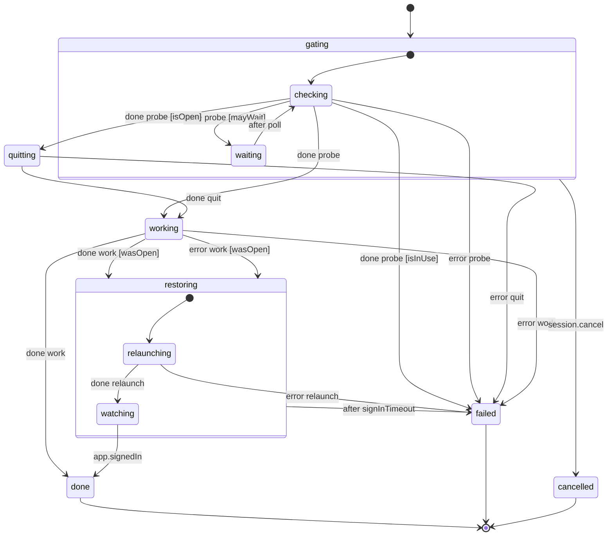

# One Soundly cloud session around Isaac's desktop app (soundly-picks, soundly-cleanup)

One session with Soundly's cloud API, for the soundly-picks and soundly-cleanup agents (`packages/atomic-agents/domains/sound/adapters/soundly/session.machine.ts`, driven by `adapters/soundly.ts`). Soundly allows one signed-in session per account, so the API sign-in signs Isaac's desktop app out; the machine leaves the app as it found it. It ends `done` (work finished and the app signed in again, or never open), `failed` with a kind (busy, unavailable, work failed, relaunch failed, not signed in), or `cancelled`.

- `gating`: looks at Soundly every 15 s while Isaac is using it (it is the app in front and he gave input in the last 2 minutes), up to the caller's patience (15 minutes for a request, none for the hourly cleanup). Cancel works only here.
- `quitting`: an open Soundly is quit the normal way before the sign-in, so a quit that fails ends the session with the app untouched.
- `working`: signs in with the app's saved login and does the work. However it ends, an app that was open is relaunched.
- `restoring`: relaunches Soundly hidden (`open -g -j`) with "Restore tabs" set to always for that launch, then reads it every 2 s (answering a Restore tabs prompt if one shows) until the log and the window show it signed in again; 2 minutes at most.

<!-- diagram:start (generated from the machine by `pnpm machines:docs`; do not edit) -->

<!-- diagram:end -->
