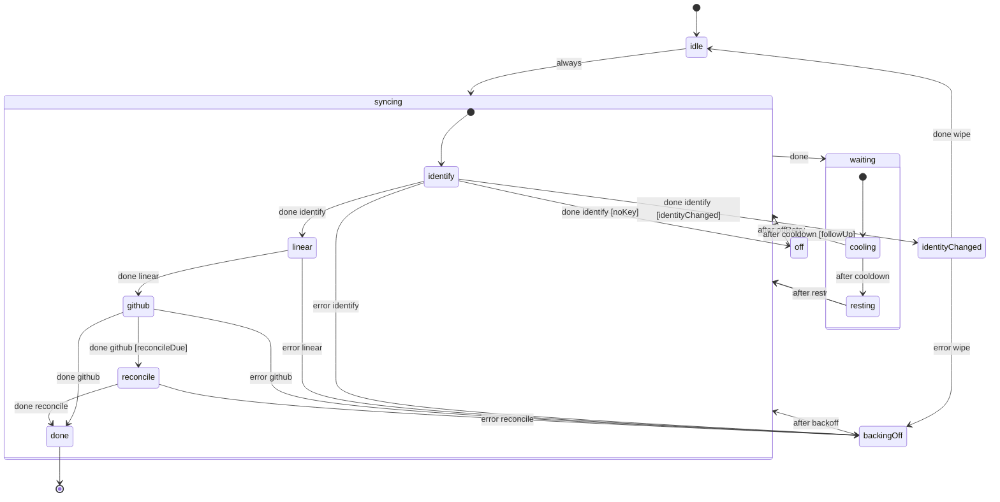

# Tickets sync (host)

The host's sync of Isaac's Linear tickets and their PRs for Relay Desktop's Board (PLAN T0.3). It runs only when host.json has `features.tickets: true`. The machine is `apps/linux/src/tickets/sync.machine.ts`; `actor.ts` gives it the real steps from `TicketsService` (`tickets/service.ts`), which pushes the board to subscribed devices after every step.

- `idle`: passes straight to `syncing`. Startup and the end of a wipe start here.
- `syncing`: one cycle. `identify` resolves the Linear viewer and gh login. `linear` reads changed issues, at most 8 pages of 25. A pass cut short resumes from its cursor next cycle, and the watermark moves only after a full pass. It also reads watched keys, the notifications and team states. `github` probes the linked PRs (20 per call) and reads full facts only for changed fingerprints. `reconcile` runs every 30 minutes and tombstones issues that left membership. A `sync.now` here becomes one follow-up cycle.
- `waiting`: `cooling` lasts the 30 s cooldown. A `sync.now` there runs once when it ends. `resting` is the rest of a 120 s +-10% interval, and a `sync.now` runs at once.
- `backingOff`: a step failed. It waits 30 s, doubling up to 30 minutes, and never less than a rate limit's `Retry-After`. `sync.now` is ignored here.
- `identityChanged`: the Linear viewer or gh login changed (or a key was revoked). The store is wiped, pending approvals are dropped, devices get an empty snapshot, and writes are refused until a full cycle finishes as the new account.
- `off`: the host has no Linear key it can use. It looks again every 10 minutes or on `sync.now`.

<!-- diagram:start (generated from the machine by `pnpm machines:docs`; do not edit) -->

<!-- diagram:end -->
