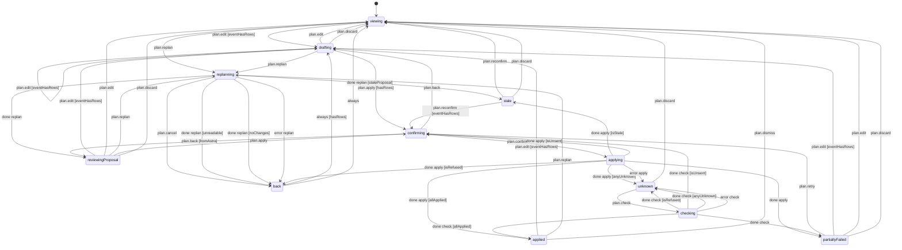

# Timeline plan draft, Apply and re-plan (desktop)

Isaac's pending changes to the Board's Timeline (`apps/desktop/src/renderer/agents-board/timeline/plan.machine.ts`, one actor per Timeline held by `plan-actor.ts`). Drags, resizes and row reorders, and Astra's re-plan, all build a draft of rows; nothing is written until Isaac confirms Apply. Each row carries its own opId (minted once, kept across edits and retries), the issue id, and the ticket's `updatedAt` and Relay start the draft was made from. Apply sends every row, Linear fields and Relay-only starts alike, as one `applyPlan` batch through the host's gate (`tickets.prepare`, then `tickets.commit` with the approval) under a batch opId. The host writes each row's Linear part and then saves its start (`plan.json`, per Linear account and issue id) only if that part is done and the start is still the one the draft was made from; failed and unknown rows leave starts untouched, and a start it couldn't save comes back as that row's failure. The host's gate remembers each row's opId: a row it already wrote, or may have written, is never sent again under another batch.

- **viewing**: no draft; the bars show Linear's dates. A message (an unreadable answer, a refusal) may still show.
- **drafting**: a manual draft. Ghost bars show the new dates, order badges the new places; each edit replaces the draft, and an edit that undoes every change goes back to viewing.
- **replanning**: Astra is re-planning the chosen project or milestone in its private item session. Cancel stops waiting and keeps the draft as it was.
- **back**: passes straight on: to the draft if there is one, else to viewing (after a re-plan that was unreadable, changed nothing, failed or was cancelled, or a refusal).
- **reviewingProposal**: Astra's plan as a draft against the host's baseline (its facts and Relay starts when Isaac asked, by issue id and for the Board's Linear account), with its summary and each row's reason. Editing it makes it a manual draft. A proposal with any row the host's live read or this board shows changed since goes to `stale` instead.
- **confirming**: the Apply confirm lists every change (key, field, old -> new). Closing it returns to the draft or the proposal. The chart takes no edits here, nor while Astra re-plans, rows write, the draft is stale or an outcome is unknown.
- **applying**: the gate writes the batch. A lost answer goes to `unknown` with the batch kept exactly as sent.
- **applied**: every row was written; the draft is empty.
- **partiallyFailed**: every row has a definite outcome and some failed; they stay in the draft with their errors (done rows left it). Retry opens the confirm again: a fresh approval under a new batch opId, the rows keep their opIds.
- **unknown**: some row may or may not be written (or no answer came back). Nothing can be edited or retried; Check again sends the same commit (same batch and row opIds, no approval), which the host answers from its record, reconciling unknown rows with Linear without sending them again. Discard drops the draft only.
- **checking**: the host is asked how the kept batch ended. Every row done: applied; still unknown: back to `unknown`; definite failures: `partiallyFailed`; a batch the host never got: back to the confirm under the same batch opId.
- **stale**: a ticket, its issue or its Relay start changed since the draft (seen before writing, the gate's conflict, or flagged in Astra's proposal): nothing was written. "Review again" re-bases the draft on the tickets as they are now and opens the confirm with that fresh comparison.

<!-- diagram:start (generated from the machine by `pnpm machines:docs`; do not edit) -->

<!-- diagram:end -->
