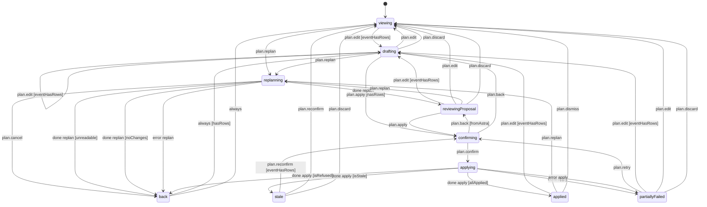

# Timeline plan draft, Apply and re-plan (desktop)

Isaac's pending changes to the Board's Timeline (`apps/desktop/src/renderer/agents-board/timeline/plan.machine.ts`, one actor per Timeline held by `plan-actor.ts`). Drags, resizes and row reorders, and Astra's re-plan, all build a draft of rows; nothing is written to Linear until Isaac confirms Apply. Each row carries its own opId (minted once, reused by every retry) and the ticket's `updatedAt` the draft was made from. Apply writes due dates, priorities and orders through the host's gate (`tickets.prepare` with `applyPlan`, then `tickets.commit` with the approval); a start-only row is Relay-only and is saved to the host's `plan.json` instead.

- **viewing**: no draft; the bars show Linear's dates. A message (an unreadable answer, a refusal) may still show.
- **drafting**: a manual draft. Ghost bars show the new dates, order badges the new places; each edit replaces the draft, and an edit that undoes every change goes back to viewing.
- **replanning**: Astra is re-planning the chosen project or milestone in its private item session. Cancel stops waiting and keeps the draft as it was.
- **back**: passes straight on: to the draft if there is one, else to viewing (after a re-plan that was unreadable, changed nothing, failed or was cancelled, or a refusal).
- **reviewingProposal**: Astra's plan as a draft, with its summary and each row's reason. Editing it makes it a manual draft.
- **confirming**: the Apply confirm lists every change (key, field, old -> new). Closing it returns to the draft or the proposal. The chart takes no edits here, nor while Astra re-plans, rows write or the draft is stale.
- **applying**: the gate writes the rows. A lost answer keeps the rows and the commit's opId, so a retry gets the stored outcome instead of writing twice.
- **applied**: every row was written; the draft is empty.
- **partiallyFailed**: the rows that didn't apply stay in the draft with their errors (done rows left it). Retry confirms them again with the same row opIds.
- **stale**: a ticket changed in Linear since the draft (seen before writing, or the gate's conflict): nothing was written. "Review again" re-bases the draft on the tickets as they are now and opens the confirm again.

<!-- diagram:start (generated from the machine by `pnpm machines:docs`; do not edit) -->

<!-- diagram:end -->
