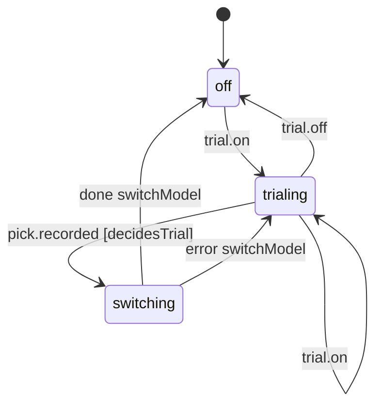

# One taste agent's blind model trial (atomic-agents trial mode)

One taste agent's blind model trial in the atomic-agents service (`packages/atomic-agents/src/core/trial.machine.ts`, driven by `TrialService.ts`; trial mode is described in `src/core/Trial.ts`). Each caller's request to the agent runs on its 2 or 3 trial models at once; Isaac picks A, B, C or "can't tell" on the card in Relay, and every pick lands here. config.json (`components.<id>.trial`, else the agent file's `trial`) says whether the trial is on.

- `off`: no trial; picks still go on the bench but count for nothing. An Undo of the last switch forgets the earlier count.
- `trialing`: counting picks on cards of exactly these models. `trial.on` again (new models from the provider catalog, or a config edit) starts the count over; at start the count goes on from the bench, after the last switch, undo or re-trial.
- `switching`: one model won about 8 of the last 10 picks, or (from 15 picks) has twice the runner-up's wins and 5 more. `switchModel` writes config.json (`model` to the winner, `trial` off) and posts `trial.switched` with the text Relay shows and the undo patch; when config cannot be written it goes back to `trialing` and the next pick decides again.

<!-- diagram:start (generated from the machine by `pnpm machines:docs`; do not edit) -->

<!-- diagram:end -->
