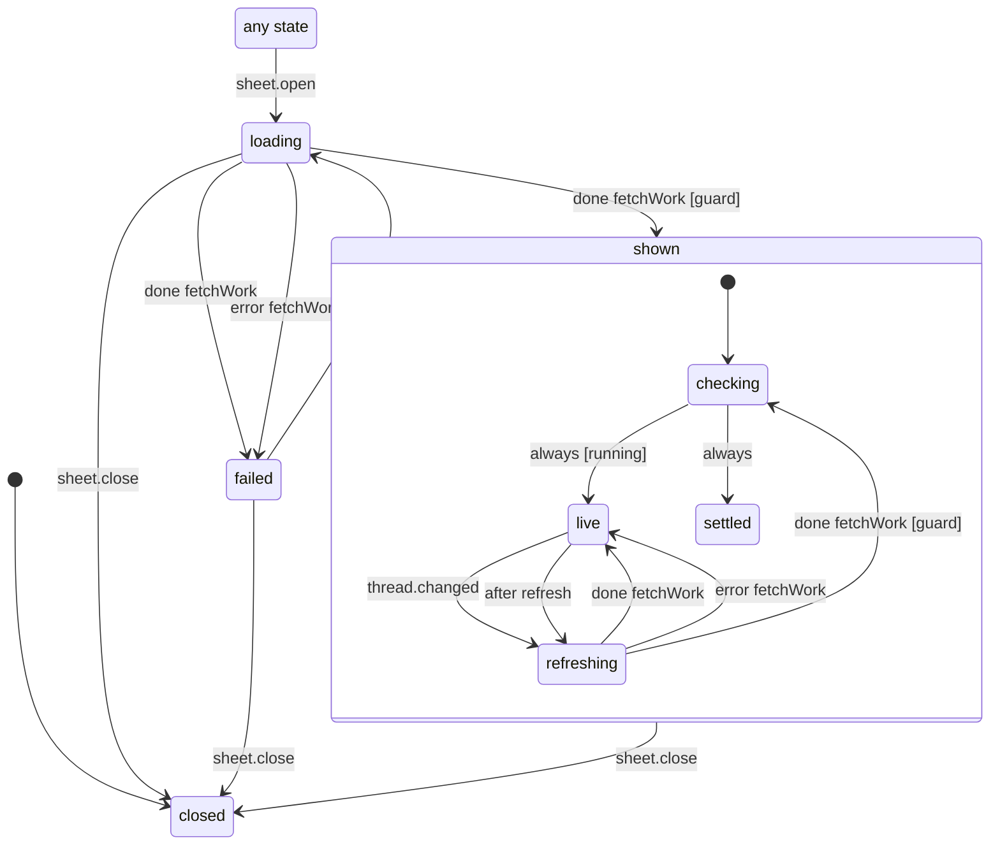

# Work sheet (peek behind the curtain)

The bottom sheet a reply's brain opens in an assistant thread (`apps/mobile/src/agents/turnWork.machine.ts`): the work behind one turn (thinking and tool steps), fetched from the host only when Isaac opens it (`assistant.work.req`), never riding on the thread's snapshots. With Settings' Show work off no brain shows, so the machine stays `closed` and nothing is fetched.

- **loading / failed**: the sheet is up and waits for the turn's work; `failed` says why (offline, a transcript gone) with Try again.
- **shown**: the work is in, pinned to the turn's own start so a newer turn never takes the sheet over. `settled` once the turn is over; while it runs, `live` asks again every 2.5 s or on a new thread snapshot (`refreshing`), keeping what shows when a refresh fails.
- A step or the thinking opens with `part.toggle`; its full text is fetched the first time only (a spawned `fetchDetail`), and an answer for a sheet already closed or moved to another turn is dropped by its `generation`.

<!-- diagram:start (generated from the machine by `pnpm machines:docs`; do not edit) -->

<!-- diagram:end -->
