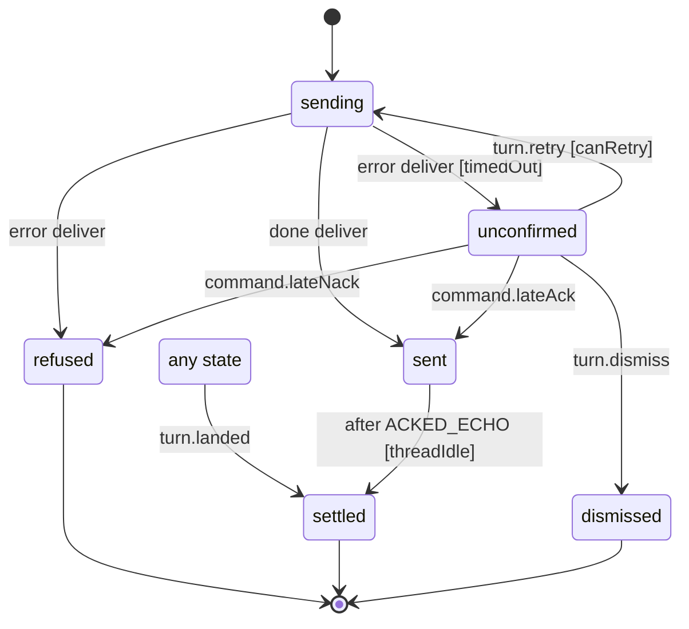

# Sent assistant turn (echo bubble)

The echo bubble of one turn Isaac sent to an assistant thread, from the tap until the turn shows as his row (`apps/mobile/src/state/turn.machine.ts`, run by `state/turns.ts`, which keeps the state in the assistant store). The bubble appears in the same tap; a timeout never gives the words back to the composer, because the turn may have landed.

- `sending`: waiting for the host's ack; the receipt says Sending.
- `sent`: the host acked it (Sent). A turn that leaves no row of Isaac's (a slash command) goes once the thread has been idle for 30 s.
- `unconfirmed`: the ack is overdue. The bubble stays with Not confirmed, Try again (the same turn and `clientId`, which the host lands once) and an x to take a stuck one away. A late ack makes it `sent`.
- `refused`: the host said no, or it never got out: the bubble goes, the words and photos go back to the composer and the banner says why.
- `settled`: its row landed in the thread (any state), or a sent turn left none.

<!-- diagram:start (generated from the machine by `pnpm machines:docs`; do not edit) -->

<!-- diagram:end -->
