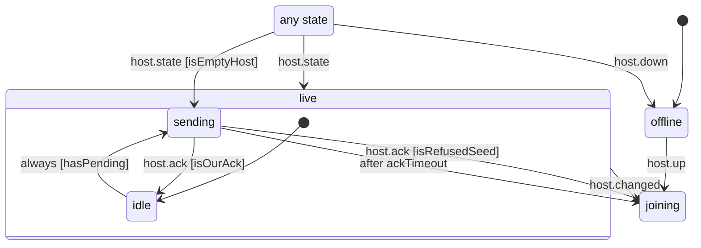

# The window mirrored across Macs through the Relay Host (desktop)

One Relay Desktop's side of the window mirror: the app tabs and the one in front, every workspace's panes (as shares, never a Mac's px) and the web pages' URLs are entries the Relay Host keeps per key, so the Mini and the MacBook show the same thing live. Each Mac sends what changes on it and shows what changes on the other, last writer wins per key; window bounds and OS focus stay per Mac. Code: `packages/shell-core/src/mirror.machine.ts`, runtime `apps/desktop/src/main/workspace/mirror.ts`.

- **offline**: no host that mirrors the window (none, an older one, or the connection dropped). Changes here wait; a state that was on its way when the link dropped is not adopted.
- **joining**: asked the host for its entries (`workspace.get`). Its answer moves on: a host holding nothing is seeded with this Mac's entries, else this Mac shows the host's and keeps only its own changes the host does not have yet.
- **live / idle**: in step with the host; another Mac's change (`workspace.changed`, the next rev) shows at once, except on keys this Mac changed and has not sent yet (this Mac's lands after it on the host). The window's echo of a shown change sends nothing back, so two Macs never ping-pong.
- **live / sending**: one put is out; changes made meanwhile wait for its ack. A refused seed (another Mac seeded first) and a put with no ack in 15 s rejoin; a skipped rev rejoins too.

<!-- diagram:start (generated from the machine by `pnpm machines:docs`; do not edit) -->

<!-- diagram:end -->
